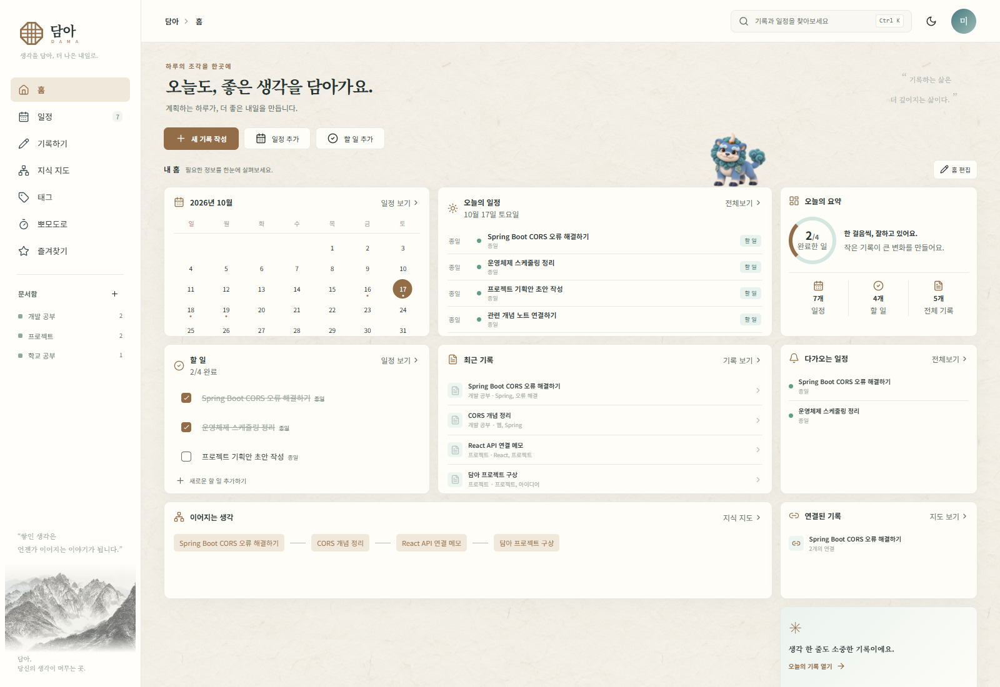

# 담아 (DAMA)

> 계획을 세우는 마음이, 하루의 실천으로 이어지도록.

## 담아를 만들게 된 이유

저는 계획을 세우는 것을 좋아합니다. 노션에 일정을 정리하고, 휴대폰 앱에 할 일을 적으며 하루를 잘 보내고 싶었습니다. 하지만 정성껏 세운 계획을 자주 다시 들여다보지는 못했고, 일정 관리도 생각처럼 꾸준히 이어지지 않았습니다.

제 하루를 돌아보니, 계획을 실천하는 과정이 여러 곳에 흩어져 있었습니다. 일정은 노션에서, 할 일은 휴대폰 앱에서, 집중할 때는 네이버 타이머를 켰습니다. 한 가지 일을 하려고 다른 창을 열고, 다시 원래의 계획으로 돌아오는 일이 반복됐습니다. 계획을 적어 둔 공간과 실제로 시간을 보내는 공간이 자꾸 멀어지고 있었습니다.

그래서 **계획을 세우고, 할 일을 확인하고, 집중하고, 오늘을 기록하는 일을 한곳에서 할 수 있으면 좋겠다**고 생각했습니다. 제 삶을 돌아보기 위해 자연스럽게 다시 찾아오는 공간. 담아는 그 필요에서 시작됐습니다.

## 다시 들어오고 싶은, 나만의 다이어리

그 공간에는 제 취향도 담고 싶었습니다. 한국 전통 문양과 한지의 질감을 오늘의 감각으로 풀어내, 차분하면서도 개성 있는 화면을 만들고자 했습니다. 사용자가 테마를 고르고, 스티커를 붙이고, 홈 카드를 배치하며 자신만의 다이어리를 꾸밀 수 있도록 했습니다.

다이어리 꾸미기와 자기 기록을 즐기는 20~30대들이 함께 사용하는 공간을 생각하며 기획했습니다. 각자의 취향에 맞게 꾸민 화면이, 오늘의 계획을 다시 펼쳐 보는 작은 이유가 되었으면 합니다.

## 작은 실천을 함께 쌓는 해태

담아에는 한국 전설 속 동물인 **해태**가 함께합니다. 듀오링고처럼 매일의 작은 활동이 다음 날 다시 찾아올 이유가 되는 경험을 떠올리며, 화면을 돌아다니는 해태에게 사용자가 하루 동안 해낸 일을 함께 담고 싶었습니다.

오늘 등록한 할 일이나 일정 하나를 완료하면 해태가 하루에 한 번 성장합니다. 해태의 레벨은 **내가 세운 계획을 하루에 하나라도 실천한 날이 얼마나 쌓였는지** 보여주는 지표가 됩니다. 통계에서는 출석과 할 일 등록 활동을 잔디처럼 차곡차곡 돌아볼 수 있습니다.

오늘 해낸 일 하나가 기록으로 남고, 그 기록이 쌓여 해태도 함께 자라는 경험. 담아가 여러분에게도 **내 하루를 담아 두고, 내일 다시 찾아오고 싶은 공간**이 되었으면 합니다.

---

[최신 업데이트·전체 변경 기록](CHANGELOG.md) · [사용 안내](docs/USAGE.md) · [버전별 릴리스](https://github.com/kjinhub/DAMA_INFO/releases) · [오류 제보·기능 제안](https://github.com/kjinhub/DAMA_INFO/issues)

아래 홈 이미지를 포함한 화면 예시는 **v0.2.0의 과거 화면**입니다. 최신 기능과 사용 방법은 아래 설명과 [사용 안내](docs/USAGE.md)를 참고하세요.

이 저장소는 담아의 프로젝트 소개, 사용 안내와 업데이트 소식을 제공합니다. 앱 소스코드는 별도의 비공개 저장소에서 관리합니다.

## 주요 기능

| 기능 | 할 수 있는 일 |
| --- | --- |
| 나만의 홈 | 달력·일정·할 일·최근 기록 카드를 이동하고 크기를 조절해 배치합니다. |
| 일정과 할 일 | 월간·주간으로 계획을 보고, 시간을 지정한 할 일과 종일 할 일을 함께 관리합니다. |
| 기록하기 | 문서함과 태그로 기록을 정리하고 관련 기록을 연결합니다. 기록 상단에서 즐겨찾기·태그를 찾습니다. |
| 활동 통계 | 최근 1년·연도별 잔디와 출석·꾸준함·계획·실행·기록의 오각형 비율을 확인합니다. |
| 친구와 알림 | 초대 코드·링크로 친구를 맺고 응원·짧은 답장과 선택한 기록을 나눕니다. 상단 종 아이콘에서 소식을 확인합니다. |
| 지식 지도 | 기록 사이의 연결을 시각적으로 살펴봅니다. |
| 뽀모도로 | 집중·휴식 시간을 정하고 전통 문양 시계로 시간을 확인합니다. |
| 배경 테마 | 한지·옥빛 한지·연지 한지·유등 밤 등 취향에 맞는 배경을 선택합니다. |
| 해태 | 활동에 따른 성장을 확인하고 이름·색상·움직임을 설정합니다. 선물받은 오라를 보관함에서 골라 적용하고, 업데이트와 친구 소식을 확인합니다. |
| 감정 스티커 | 기쁨·슬픔·분노·우울함 등 32종으로 날짜와 일정·할 일에 감정을 표현합니다. |
| 계정 보호 | 이메일을 인증해 비밀번호 재설정 링크를 받고, 비밀번호 변경·복구 코드를 관리합니다. |
| 앱 설치·업데이트 | 지원 브라우저에서 앱으로 설치하고, 앱 정보에서 버전별 변경 내용을 확인합니다. |
| 서비스 공지 | 로그인한 화면에서 게시 중인 서비스 안내를 확인합니다. |

관리자는 같은 사이트의 `/admin`에서 회원 관리와 공지·작업 기록을 관리하고, 회원에게 오라를 영구 선물할 수 있습니다. 일반 회원과 관리자 권한은 서버에서 구분하며, 관리자 화면에 개인 기록·일정·첨부 내용을 열람하는 기능은 제공하지 않습니다.

## 최신 업데이트: v1.2.0 · 2026-10-20

- 관리자가 보낸 오라를 계속 보유하고, **해태 설정 → 오라 보관함**에서 원하는 효과를 바꿔 적용합니다.
- 궁궐 오라를 착용하면 해태가 기존 이동 경로에서 공중 활공 자세로 움직입니다.
- 자세한 방법은 [해태 설정과 성장](docs/USAGE.md#해태-설정과-성장)과 [업데이트 기록](CHANGELOG.md)에서 확인하세요.

이전 버전에서는 친구 응원·해태 방문·공통 일정(v1.1.0·v0.9.0), 주간 일정과 홈 위젯의 자동 재배치(v0.8.0), 이메일 인증과 비밀번호 입력 조건 조정(v1.0.0·v0.7.2)을 추가했습니다. v0.2.0부터의 전체 변경 내용은 [업데이트 기록](CHANGELOG.md)과 [버전별 릴리스](https://github.com/kjinhub/DAMA_INFO/releases)에서 확인할 수 있습니다.

현재 열린 앱에 적용된 버전은 **계정 및 설정 → 앱 정보**에서 확인하세요. 설치된 앱에도 운영 업데이트가 반영되므로 버전마다 다시 다운로드할 필요는 없습니다. 새 버전 안내가 나오면 작성 중인 내용을 저장하고 모든 담아 창을 닫은 뒤 다시 엽니다.

## 의견 보내기

[Issues](https://github.com/kjinhub/DAMA_INFO/issues)에서 오류를 제보하거나 기능을 제안할 수 있습니다. 오류 제보에는 사용 기기·브라우저, 발생 과정, 기대한 결과를 함께 적어 주세요. 화면을 첨부할 때는 이름·연락처·개인 기록 등을 가려 주세요. 비밀번호와 복구 코드는 게시하지 마세요.
