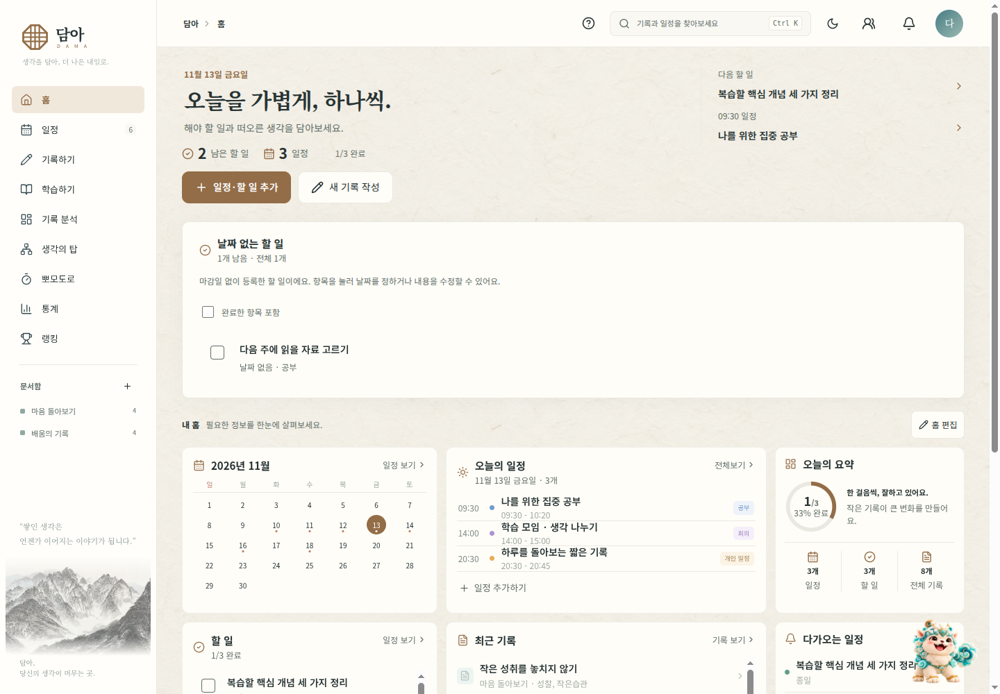

# 담아 (DAMA)

> 계획을 세우는 마음이, 하루의 실천으로 이어지도록.

## 담아를 만들게 된 이유

저는 계획을 세우는 것을 좋아합니다. 노션에 일정을 정리하고, 휴대폰 앱에 할 일을 적으며 하루를 잘 보내고 싶었습니다. 하지만 정성껏 세운 계획을 자주 다시 들여다보지는 못했고, 일정 관리도 생각처럼 꾸준히 이어지지 않았습니다.

제 하루를 돌아보니, 계획을 실천하는 과정이 여러 곳에 흩어져 있었습니다. 일정은 노션에서, 할 일은 휴대폰 앱에서, 집중할 때는 네이버 타이머를 켰습니다. 한 가지 일을 하려고 다른 창을 열고, 다시 원래의 계획으로 돌아오는 일이 반복됐습니다. 계획을 적어 둔 공간과 실제로 시간을 보내는 공간이 자꾸 멀어지고 있었습니다.

그래서 **계획을 세우고, 할 일을 확인하고, 집중하고, 오늘을 기록하는 일을 한곳에서 할 수 있으면 좋겠다**고 생각했습니다. 제 삶을 돌아보기 위해 자연스럽게 다시 찾아오는 공간. 담아는 그 필요에서 시작됐습니다.

## 다시 들어오고 싶은, 나만의 다이어리

그 공간에는 제 취향도 담고 싶었습니다. 한국 전통 문양과 한지의 질감을 오늘의 감각으로 풀어내, 차분하면서도 개성 있는 화면을 만들고자 했습니다. 사용자가 테마를 고르고, 스티커를 붙이고, 홈 카드를 배치하며 자신만의 다이어리를 꾸밀 수 있도록 했습니다.

다이어리 꾸미기와 자기 기록을 즐기는 20~30대들이 함께 사용하는 공간을 생각하며 기획했습니다. 각자의 취향에 맞게 꾸민 화면이, 오늘의 계획을 다시 펼쳐 보는 작은 이유가 되었으면 합니다.

## 작은 실천을 함께 쌓는 해태

담아에는 한국 전설 속 동물인 **해태**가 함께합니다. 듀오링고처럼 매일의 작은 활동이 다음 날 다시 찾아올 이유가 되는 경험을 떠올리며, 화면을 돌아다니는 해태에게 사용자가 하루 동안 해낸 일을 함께 담고 싶었습니다.

오늘 등록한 할 일을 완료하면 해태가 하루에 한 번 성장합니다. 해태의 레벨은 **내가 세운 계획을 하루에 하나라도 실천한 날이 얼마나 쌓였는지** 보여주는 지표가 됩니다. 통계에서는 출석과 할 일 등록 활동을 잔디처럼 차곡차곡 돌아볼 수 있습니다.

오늘 해낸 일 하나가 기록으로 남고, 그 기록이 쌓여 해태도 함께 자라는 경험. 담아가 여러분에게도 **내 하루를 담아 두고, 내일 다시 찾아오고 싶은 공간**이 되었으면 합니다.

---

[담아 열기](https://dama-kjinhub-2026.duckdns.org) · [최신 업데이트·전체 변경 기록](CHANGELOG.md) · [사용 안내](docs/USAGE.md) · [버전별 릴리스](https://github.com/kjinhub/DAMA_INFO/releases) · [오류 제보·기능 제안](https://github.com/kjinhub/DAMA_INFO/issues)

아래 홈 이미지를 포함한 화면 예시는 **v0.2.0의 과거 화면**입니다. 최신 기능과 사용 방법은 아래 설명과 [사용 안내](docs/USAGE.md)를 참고하세요.

이 저장소는 담아의 프로젝트 소개, 사용 안내와 업데이트 소식을 제공합니다. 앱 소스코드는 별도의 비공개 저장소에서 관리합니다.

## 주요 기능

| 기능 | 할 수 있는 일 |
| --- | --- |
| 나만의 홈 | 오늘의 계획과 빠른 작성을 확인하고, 달력·일정·할 일·최근 기록 카드를 이동하거나 크기를 조절합니다. 다음 할 일은 상세 확인 뒤 수정·완료를 따로 선택합니다. |
| AI로 계획 정리 | 빈 화면에서 새 요청을 작성하거나 보관한 초안을 골라 이어 씁니다. 일정·할 일 카드를 확인·수정한 뒤 종류별 개수를 보고 확정합니다. |
| 일정과 할 일 | 월간·주간으로 계획을 보고, 휴대폰에서는 오늘의 일정·할 일 목록을 확인합니다. 직접 등록창에서는 저장을 눌러 등록하며 기기 초안은 보관하지 않습니다. AI 등록 초안은 별도로 서버에 이어서 보관합니다. Google 캘린더를 자동으로 연결하고 추가 권한 승인 후 Google Tasks도 가져옵니다. 완료 체크는 할 일에 사용합니다. |
| 기록하기 | 별도 목록과 넓은 편집기에서 기록을 쓰고, 문서함·태그·즐겨찾기와 열린 기록 탭으로 정리합니다. |
| 기록 분석과 질문 취향 | 요일·시간대별 기록 작성 패턴과 일정 등록 수·할 일 완료율을 살펴봅니다. 홈이나 기록 분석에서 하루 세 사색 질문에 답하고, 좋아요·질문 교체·관심 주제와 깊이로 질문 취향을 조절합니다. AI 전송은 기본 허용이며, 직접 꺼 둔 설정은 유지하고 원할 때 끌 수 있습니다. |
| 생각의 탑 | 저장한 기록을 돌블록으로 쌓고 선택한 펫과 함께 높이·다음 쉼터를 확인합니다. 돌에서 기록 원문을 펼치거나 편집 화면으로 이동합니다. |
| 활동 통계와 배지 | 최근 1년·연도별 잔디와 출석·꾸준함·계획·실행·기록의 오각형 비율을 확인하고, 획득한 배지의 진행률·관련 활동을 볼 수 있습니다. |
| 랭킹 | 누적 **Lv. 펫**과 이번 주 기록·계획·실행·응원을 친구 또는 전체 사용자와 비교합니다. 선택한 펫과 색도 볼 수 있습니다. |
| 친구와 알림 | 초대 코드·링크로 친구를 맺고 응원·짧은 답장과 선택한 기록을 나눕니다. 상단 종 아이콘에서 소식을 확인합니다. |
| 뽀모도로 | 집중·휴식 시간을 정하고 전통 문양 시계로 확인하거나 친구와 같은 방에서 함께 집중합니다. |
| 배경 테마 | 한지·옥빛 한지·연지 한지·유등 밤 등 취향에 맞는 배경을 선택합니다. |
| 펫 | 해태·아기 봉황·고양이 소녀 중 함께할 펫을 고르고, 선물받은 고양이 소년·분홍 햄스터·청룡도 선택할 수 있습니다. 활성 관리자는 신규 펫 세 종을 선물 없이 선택할 수 있습니다. 펫 색을 바꾼 뒤 기본 색으로 되돌릴 수 있습니다. 색상과 함께하기 동작을 설정하고 선택한 펫을 친구에게 보낼 수 있습니다. |
| 감정 스티커 | 기쁨·슬픔·분노·우울함 등 32종으로 날짜와 일정·할 일에 감정을 표현합니다. |
| 계정 보호 | 이메일을 인증해 비밀번호 재설정 링크를 받고, 비밀번호 변경·복구 코드를 관리합니다. |
| 앱 설치·업데이트 | 지원 브라우저에서 앱으로 설치하고, 앱 정보에서 버전별 변경 내용을 확인합니다. |
| 서비스 공지 | 알림함에서 관리자 공지와 리뷰 이벤트를 확인합니다. 새 공지는 짧은 상단 알림과 선택한 펫이 알려줍니다. |

관리자는 같은 사이트의 `/admin`에서 회원 관리와 공지·비공개 리뷰 접수·작업 기록을 관리하고, 회원에게 오라나 펫을 선물할 수 있습니다. 서비스 상태에서는 최근 성공한 백업·배포 시각을 확인할 수 있습니다. 일반 회원과 관리자 권한은 서버에서 구분하며, 관리자 화면에 개인 기록·일정·첨부 내용을 열람하는 기능은 제공하지 않습니다.

## 최신 업데이트: v4.38.0 · 2026-11-12

- AI 추가는 빈 작성 화면으로 시작하고 보관한 초안을 선택해 이어 쓸 수 있어요. 열기만으로 빈 초안을 만들지 않아요.
- AI 날짜 수정의 답변·카드·실제 저장값을 일치시키고, 실제 반영된 날짜 변경을 표시해요.
- 모바일 등록창과 시간 선택 공간을 넓히고 추가 설정을 접어 필수 입력과 저장을 쉽게 했어요.
- 저장 오류를 두 테마에서 읽기 쉽게 표시하고 제목 수정·재시도와 저장 버튼에 바로 접근할 수 있어요.
- 기록하기 탭은 목록으로 돌아오고 월간 상세·펫 설정의 모바일 탐색을 정리했어요.
- 웹·API 업데이트입니다. Flutter 앱은 버전 정보만 맞췄으며, 새 설치 파일·스토어 출시는 별도입니다.
- [v4.38.0 릴리스](https://github.com/kjinhub/DAMA_INFO/releases/tag/v4.38.0) · [사용 안내](docs/USAGE.md)

## 이전 업데이트: v4.37.1 · 2026-11-12

- AI 일정 입력에서 Enter로 요청을 보내고 Shift+Enter로 줄을 바꿀 수 있어요. 한글 조합 중에는 전송하지 않아요.
- 수업·현장실습처럼 문맥이 충분하면 오전·오후를 해석해 초안에 표시하고, 판단하기 어려울 때만 질문해요.
- 직접 정한 시간과 이미 답한 오전·오후를 유지하고, 시간 해석의 근거를 카드에서 확인할 수 있어요.
- [v4.37.1 릴리스](https://github.com/kjinhub/DAMA_INFO/releases/tag/v4.37.1) · [AI 등록 사용법](docs/USAGE.md#ai로-일정할-일-추가하기)

## 이전 업데이트: v4.37.0 · 2026-11-11

- **일정·할 일 추가** 메뉴에서 직접 입력하거나 **AI로 정리하기**를 고릅니다. 펫에서도 같은 등록 초안을 이어서 엽니다.
- 한 문장에 섞인 일정과 할 일을 카드로 나누고 필요한 날짜·시간만 확인합니다. 카드에서 수정·제외하고 **선택한 N개 등록하기**로 확정합니다.
- 대화 중 동의하거나 창을 닫는 것으로 등록되지 않습니다. 저장 결과 확인과 중복 등록 방지를 지원합니다.
- 웹·API 운영 업데이트입니다. Flutter 코드·API 연결도 준비했으며 새 설치 파일·스토어 출시는 별도입니다.
- [AI 일정 등록 사용법](docs/USAGE.md#ai로-일정할-일-추가하기) · [v4.37.0 릴리스](https://github.com/kjinhub/DAMA_INFO/releases/tag/v4.37.0)

## 이전 업데이트: v4.36.1 · 2026-11-11

터치 위치의 잔물결, 체크·선택 표시의 움직임, 목록 순차 표시와 검색 대기 시머를 더했습니다. 움직임 줄이기 설정을 반영합니다. [변경 기록](CHANGELOG.md)

## 이전 업데이트: v4.36.0 · 2026-11-11

버튼·탭·날짜 선택과 할 일 완료·저장 결과 안내를 개선했습니다. 저장 실패 시 상태 복구와 재시도를 지원하고 오늘의 질문의 AI 안내 영역을 정리했습니다. [변경 기록](CHANGELOG.md)

## 이전 업데이트: v4.35.0 · 2026-11-10

- AI 질문을 **기본 사용**으로 바꿔 별도 동의 체크 없이 이용할 수 있습니다. 이전에 직접 꺼 둔 설정은 유지합니다.
- 홈과 기록 분석에서 전송 안내를 확인하고 **AI 사용 설정**에서 켜거나 끌 수 있습니다. 기록 일부·질문 취향·직접 남긴 반응이 OpenAI로 전송됩니다.
- AI를 꺼도 일반 사색 질문, 질문 취향과 답변 기록을 계속 사용할 수 있습니다. 연결이 준비되지 않았을 때는 일반 사색 질문을 제공합니다.
- [사용 안내](docs/USAGE.md#기록-분석과-오늘의-질문) · [v4.35.0 릴리스](https://github.com/kjinhub/DAMA_INFO/releases/tag/v4.35.0)

## 이전 업데이트: v4.34.0 · 2026-11-10

- 오늘의 질문을 공부 내용을 확인하는 퀴즈보다 사색과 자기 성찰에 맞췄습니다.
- **좋아요 / 다른 질문을 받고 싶어요**로 질문에 대한 반응을 남기고, **질문 취향**에서 관심 주제와 깊이를 고를 수 있습니다. ‘시험처럼 느껴져요’는 배움이라는 주제를 싫어한다는 뜻으로 처리하지 않습니다.
- 직접 고른 취향과 반응을 참고하면서 다른 관점의 질문도 함께 준비합니다. 답변 문장으로 성격을 진단하지 않으며, 취향을 초기화해도 작성한 답변 기록은 남습니다.
- 기록을 참고하는 AI를 사용하려면 갱신된 안내에 다시 동의해 주세요. 일반 질문과 수동 취향 설정은 동의 없이도 이용할 수 있습니다. [사용 안내](docs/USAGE.md#기록-분석과-오늘의-질문) · [v4.34.0 릴리스](https://github.com/kjinhub/DAMA_INFO/releases/tag/v4.34.0)

현재 AI 사용 정책은 위의 v4.35.0 기본 사용 안내를 따릅니다.

## 이전 업데이트: v4.33.1 · 2026-11-10

휴대폰의 **더보기** 메뉴가 오른쪽에서 부드럽게 열리고 닫힙니다. 배경 페이드·움직임 줄이기 설정을 반영하며, 메뉴를 닫으면 원래 버튼으로 포커스가 돌아갑니다. [v4.33.1 릴리스](https://github.com/kjinhub/DAMA_INFO/releases/tag/v4.33.1)

## 이전 업데이트: v4.33.0 · 2026-11-10

모바일 홈에서 오늘의 계획과 빠른 작성을 쉽게 찾고 목록·작성 화면을 더 편하게 사용합니다. **다음 할 일**은 상세 확인 후 수정·완료를 선택하고, 기록 분석에서는 한국 시간 기준 **요일별 기록 시간대**를 확인합니다. 휴대폰 웹의 펫은 홈 전용 자리에 있어 목록과 입력을 가리지 않습니다. Flutter 화면 개선도 코드에 포함했으며, 새 설치 파일이나 스토어 배포를 뜻하지 않습니다. [v4.33.0 릴리스](https://github.com/kjinhub/DAMA_INFO/releases/tag/v4.33.0)

## 이전 업데이트: v4.32.1 · 2026-11-09

- 다른 기록이나 할 일의 저장 오류 때문에 새 일정 등록까지 막히는 문제를 수정했습니다.
- 저장하지 못한 항목은 이름과 원인이 남으며, 해당 항목만 수정하거나 다시 저장할 수 있습니다.
- 이번 버전에는 생각의 탑, 바이올렛 동작 메뉴, 관리자 운영 개요 등 최근 기능도 포함됩니다. 자세한 내용은 [업데이트 기록](CHANGELOG.md)과 [사용 안내](docs/USAGE.md)를 확인하세요.

## 이전 업데이트: v4.28.0 · 2026-11-01

펫이 상자 윗면과 화면 하단을 발판으로 사용합니다. 끌어서 놓을 때 착지할 위치를 미리 보여주고 상자의 이동·스크롤을 따라갑니다. 상자 안쪽에는 머무르지 않으며, 하단에는 항상 펫이 있을 바닥을 확보합니다. 일정·할 일 등록의 기기 초안 저장과 상단 초안 확인·접기 안내도 제거했습니다. [사용 안내](docs/USAGE.md) · [v4.28.0 릴리스](https://github.com/kjinhub/DAMA_INFO/releases/tag/v4.28.0)

## 이전 업데이트: v4.27.0 · 2026-11-01

펫을 버튼·카드·빈 공간에 자유롭게 놓을 수 있고, 겹쳐도 강제로 옮기거나 숨기지 않습니다. 빈 곳을 더블클릭하면 펫이 짧게 이동해 옵니다. 자동 산책은 발판이 있는 곳에서만 하며, 기록 분석에서도 펫이 함께합니다. **잠깐 비켜주기 / 원래 자리로**로 저장 위치를 유지하면서 작업 공간을 확보할 수 있습니다. [사용 안내](docs/USAGE.md#펫-선택색상과-성장) · [v4.27.0 릴리스](https://github.com/kjinhub/DAMA_INFO/releases/tag/v4.27.0)

## 이전 업데이트: v4.26.0 · 2026-10-31

펫이 카드 윗변과 화면 하단을 발판으로 사용합니다. 끌면 실제 착지할 발판과 위치가 초록색으로 보이고, 방해하는 버튼·입력칸·차트 등의 실제 영역은 빨간 경계로 표시됩니다. 자동 산책은 현재 발판 안에서 이어지며 봉황·청룡의 비행과 펫별 반응도 사용할 수 있습니다. [자세한 사용법](docs/USAGE.md#펫-선택색상과-성장) · [v4.26.0 릴리스](https://github.com/kjinhub/DAMA_INFO/releases/tag/v4.26.0)

## 이전 업데이트: v4.25.4 · 2026-10-31

- 놓기 어려운 요청 위치는 빨간 경계와 이유로, 실제 놓일 안전한 위치는 초록 경계로 구분합니다.
- 빈 작업 영역을 더블클릭해 펫을 부를 수 있습니다.
- 햄스터 볼 부풀리기·봉황 지저귀기 등 여섯 펫의 전용 반응과 따라오기·비행 메뉴를 복원했습니다.

## 이전 업데이트: v4.25.3 · 2026-10-31

- 펫을 드래그하면 배치 참고선과 실제 놓일 영역이 다시 보입니다.
- 버튼·차트를 피할 위치를 미리 확인할 수 있고, 놓을 공간이 없으면 원래 배치를 유지합니다. 상하좌우 자유 이동은 계속 사용할 수 있습니다.

## 이전 업데이트: v4.25.2 · 2026-10-31

- 펫을 상하좌우로 드래그해 원하는 안전한 위치에 놓을 수 있습니다. 놓은 높이를 기억하며 바닥으로 강제 복귀하지 않습니다.
- 같은 브라우저·계정에서 위치를 기억하고 네 방향키로도 옮길 수 있습니다. 자동 이동은 놓은 높이에서 좌우로 이어집니다.

## 이전 업데이트: v4.25.1 · 2026-10-31

- 하단 버튼과 겹친 펫이 숨겨진 채 남는 문제를 수정했습니다.
- 앱 업데이트 안내에서 Google 캘린더 연결과 Tasks 추가 승인 방법을 확인할 수 있습니다.
- Google 할 일을 가져오려면 **계정 및 설정 → 데이터 관리 → Google 캘린더·할 일 연동 → Google Tasks 권한 추가 승인**을 한 번 진행하세요.

## 이전 업데이트: v4.25.0 · 2026-10-31

- 담아에 접속하거나 앱으로 돌아오면 구글 일정·할 일 변경을 바로 확인하도록 요청합니다.
- Google 일반 일정은 변경 알림을 받아 동기화하고, 화면을 열어두면 추가 조회합니다. 기존 2분 주기는 보조로 유지합니다.
- 미저장 일정과 작성 중 내용을 보존하고 연속 요청은 합칩니다. 서버·웹 실행 환경과 로그인·푸시 보안 라이브러리도 업데이트했습니다.
- Google Tasks는 기존 추가 권한 승인과 날짜 기준 표시 제한이 유지됩니다. [사용 안내](docs/USAGE.md)에서 확인하세요.

## 이전 업데이트: v4.24.0 · 2026-10-31

- Google Tasks의 모든 할 일 목록에서 제목·날짜·완료 상태를 담아 할 일로 가져옵니다. 기존 사용자는 데이터 관리에서 **Google Tasks 권한 추가 승인**을 진행하세요.
- Google API는 Tasks 예약 시각을 제공하지 않으므로 날짜 있는 종일 할 일로 표시합니다. 일반 일정은 시작·종료 시간까지 동기화합니다.
- 읽기 전용 캘린더와 생일·집중 시간 등 더 많은 일정 유형을 가져옵니다. 선택한 캘린더와 기존 조회 기간에 적용됩니다.
- 하단에 고정한 펫의 좌우 자동 산책도 다시 사용할 수 있습니다. [사용 안내](docs/USAGE.md)와 [변경 기록](CHANGELOG.md)을 참고하세요.

## 이전 업데이트: v4.23.0 · 2026-10-30

- Google 로그인과 캘린더 자동 동기화를 제공합니다. 개인 일정·수락한 공유 일정·날짜 있는 할 일을 Google의 일반 일정으로 등록하고, 기존 권한과 원래 항목을 유지합니다.
- 처음 한 번 캘린더 권한을 승인해야 합니다. 기존 연결은 확대된 등록 범위를 확인하고 재승인하세요. [사용 안내](docs/USAGE.md)에서 연결 방법과 제한을 확인할 수 있습니다.

## 이전 업데이트: v4.22.2 · 2026-10-30

- 일정·할 일 작성창과 미저장 초안 목록에서 **초안 버리기** 버튼을 제거했습니다. 창을 닫아도 입력은 이 기기에 남고, 서버에 저장된 것이 확인되면 자동으로 정리됩니다.
- 변경 내용을 더 자세히 보려면 [사용 안내](docs/USAGE.md)와 [업데이트 기록](CHANGELOG.md)을 확인하세요.

## 이전 업데이트: v4.22.0 · 2026-10-30

- 휴대폰 일정 탭에 오늘 일정·할 일 목록을 추가했습니다. 관리자는 회원·공지·리뷰 이력을 검색하고, 여러 회원에게 펫과 오라를 일괄 선물할 수 있습니다.
- Google 캘린더 선택 일정 동기화(v4.21.0), 일정·할 일 기기 초안 복구(v4.20.0), 활동 배지(v4.15.0~v4.19.0)도 추가됐습니다. [전체 변경 기록](CHANGELOG.md)에서 버전별 내용을 볼 수 있습니다.

## 이전 업데이트: v4.13.0 · 2026-10-28

- 펫은 서울 날짜 기준 앱에 접속한 날마다 하루 한 번 성장합니다. 할 일을 완료할 필요는 없으며, 같은 날 다시 접속해도 중복으로 오르지 않습니다. 기존 레벨을 유지하고 저장된 과거 출석 기록도 반영합니다.
- 자세한 방법은 [사용 안내](docs/USAGE.md)와 [업데이트 기록](CHANGELOG.md)에서 확인하세요.

## 이전 업데이트: v4.12.0 · 2026-10-28

- 각 펫의 색상 설정에서 **기본 색으로 되돌리기**를 누르면 원래 색을 미리 볼 수 있습니다. **적용**을 눌러 계정에 저장합니다. 고양이·햄스터의 머리/털과 옷 색은 각각 따로 복원할 수 있습니다.
- 자세한 방법은 [사용 안내](docs/USAGE.md)와 [업데이트 기록](CHANGELOG.md)에서 확인하세요.

## 이전 업데이트: v4.11.1 · 2026-10-28

- 활성 관리자는 고양이 소년·분홍 햄스터·청룡을 선물받지 않아도 선택할 수 있습니다. 일반 회원은 기존처럼 선물받은 펫을 보관함에서 선택합니다.
- 자세한 방법은 [사용 안내](docs/USAGE.md)와 [업데이트 기록](CHANGELOG.md)에서 확인하세요.

## 이전 업데이트: v4.11.0 · 2026-10-28

- 관리자 공지를 **알림함 → 관리자 공지**에서 확인합니다. 새 공지의 짧은 상단 알림이나 펫의 **확인하기**를 누르면 해당 본문을 엽니다.
- 청룡의 **자유 비행**은 기류와 잔상을 남기며 마우스를 따라갑니다. 청룡을 잡아 드래그하면 구름 소환·비행·착지 동작을 보여줍니다.
- 청룡이 화면의 카드에 막혀 멈추던 문제와 비행 중 흐려지는 현상을 고쳤습니다. 몸통 자세는 일정하게 유지하고, 마우스를 향해 좌우 방향을 바꿉니다.
- 리뷰 이벤트는 알림함의 공지 본문에서 참여하고 접수 상태를 확인할 수 있습니다.
- 자세한 방법은 [사용 안내](docs/USAGE.md)와 [업데이트 기록](CHANGELOG.md)에서 확인하세요.

이전 버전에서는 관리자의 최근 백업·배포 성공 시각 확인(v4.10.0), 새 펫과 비공개 리뷰 이벤트(v4.9.0), 선택한 펫의 친구 방문과 Lv. 펫 랭킹(v4.8.0), 시간표 카드의 시간 조절과 고양이 소녀(v4.7.0), 봉황 커서 따라오기(v4.6.0), 일정 복사(v4.4.0), 기록 분석과 오늘의 질문(v4.0.0~v4.3.3) 등을 추가했습니다. v0.2.0부터의 전체 변경 내용은 [업데이트 기록](CHANGELOG.md)에서 확인할 수 있습니다.

현재 열린 앱에 적용된 버전은 **계정 및 설정 → 앱 정보**에서 확인하세요. 설치된 앱에도 운영 업데이트가 반영되므로 버전마다 다시 다운로드할 필요는 없습니다. 새 버전 안내가 나오면 작성 중인 내용을 저장하고 모든 담아 창을 닫은 뒤 다시 엽니다.

## 의견 보내기

[Issues](https://github.com/kjinhub/DAMA_INFO/issues)에서 오류를 제보하거나 기능을 제안할 수 있습니다. 오류 제보에는 사용 기기·브라우저, 발생 과정, 기대한 결과를 함께 적어 주세요. 화면을 첨부할 때는 이름·연락처·개인 기록 등을 가려 주세요. 비밀번호와 복구 코드는 게시하지 마세요.

