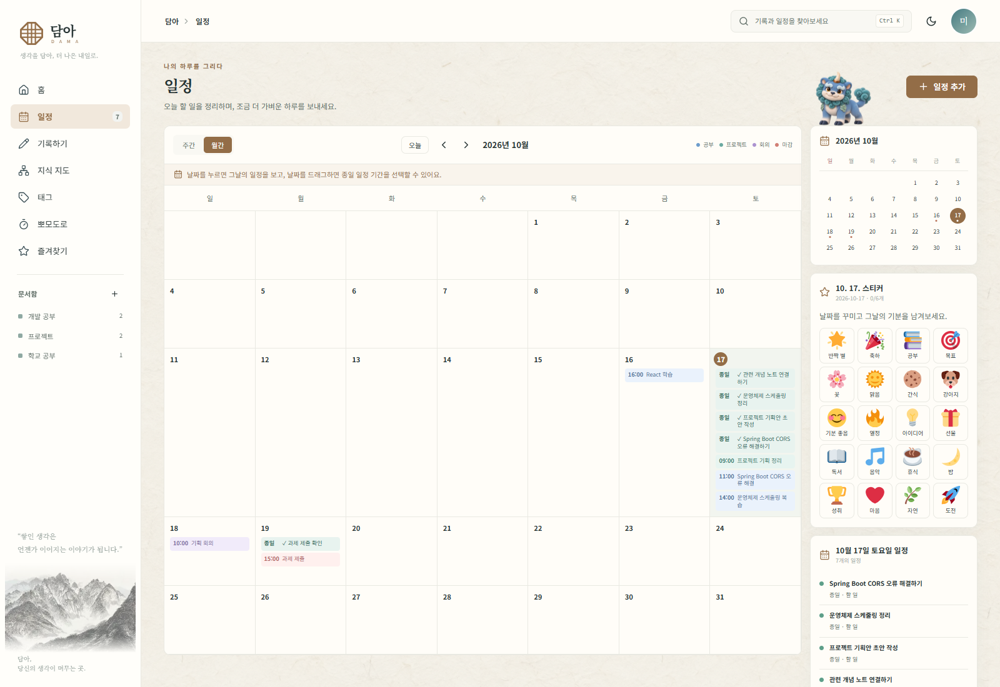
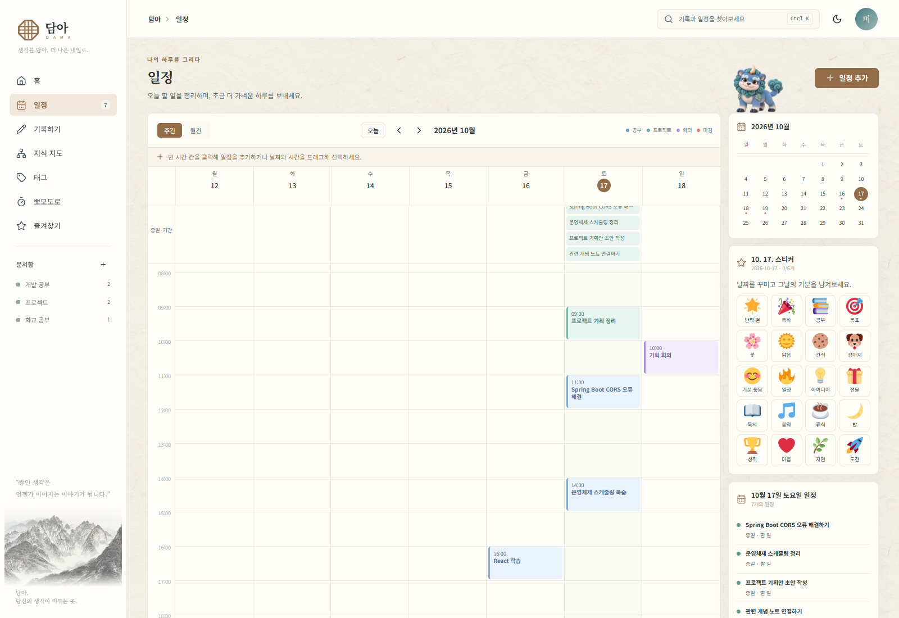
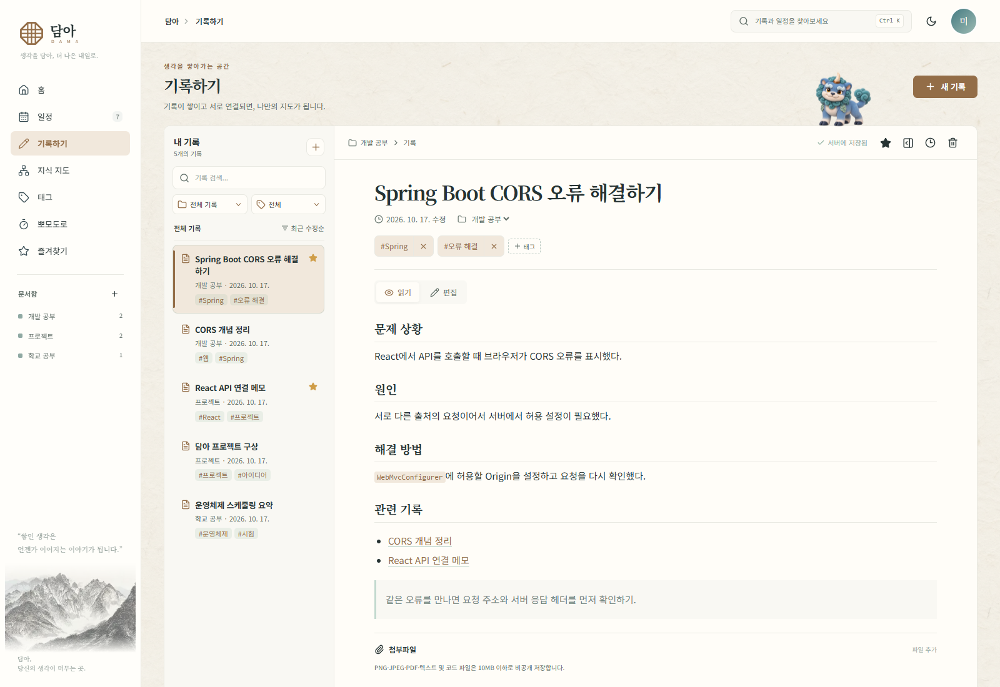
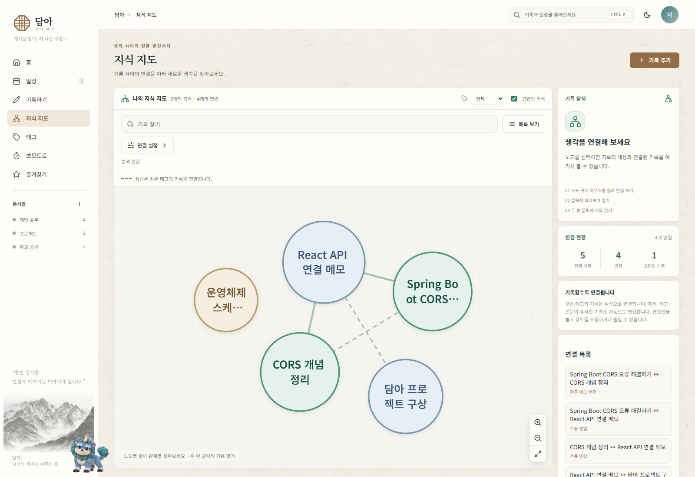
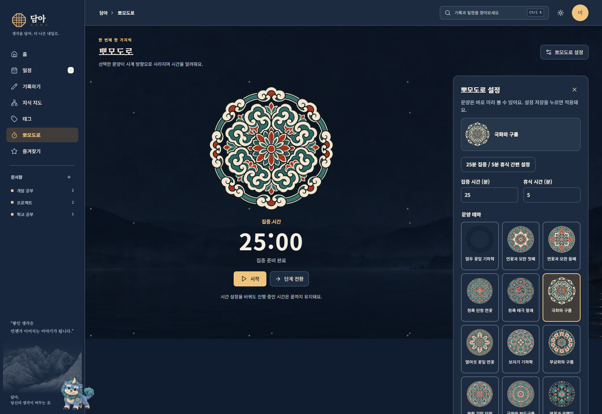

# 담아 (DAMA)

> 생각을 담아, 더 나은 내일로.

**담아**는 기록, 일정, 할 일을 한곳에 모으고 서로 연결하는 웹앱입니다. 한지와 전통 문양을 담은 화면에서 하루를 계획하고, 기록을 돌아보고, 뽀모도로로 집중 시간을 관리할 수 있습니다.

[최신 업데이트](https://github.com/kjinhub/DAMA_INFO/releases/latest) · [전체 업데이트 기록](CHANGELOG.md) · [사용 안내](docs/USAGE.md) · [오류 제보·기능 제안](https://github.com/kjinhub/DAMA_INFO/issues)

이 저장소는 담아의 프로젝트 소개, 사용 안내와 업데이트 소식을 제공합니다. 앱 소스코드는 별도의 비공개 저장소에서 관리합니다.

## 주요 기능

| 기능 | 할 수 있는 일 |
| --- | --- |
| 나만의 홈 | 달력·일정·할 일·최근 기록 카드를 이동하고 크기를 조절해 배치합니다. |
| 일정과 할 일 | 월간·주간으로 계획을 보고, 시간을 지정한 할 일과 종일 할 일을 함께 관리합니다. |
| 기록하기 | 문서함과 태그로 기록을 정리하고 관련 기록을 연결합니다. |
| 지식 지도 | 기록 사이의 연결을 시각적으로 살펴봅니다. |
| 뽀모도로 | 집중·휴식 시간을 정하고 전통 문양 시계로 시간을 확인합니다. |
| 배경 테마 | 한지·옥빛 한지·연지 한지·유등 밤 등 취향에 맞는 배경을 선택합니다. |
| 해태 | 화면을 함께 다니는 해태를 만나고 활동에 따른 성장을 확인합니다. |

## 화면 미리보기

아래 이미지는 **v0.2.0 로컬 미리보기의 실제 웹 화면**입니다. 2026년 10월 17일에 기본 예시 데이터로 촬영했습니다. 실행 환경과 화면 크기에 따라 배치가 달라질 수 있습니다.

### 월간 일정

날짜별 일정과 할 일을 함께 확인합니다. 일정이 많은 주는 행 높이가 늘어나 모든 항목을 보여줍니다. 날짜 범위를 드래그하면 여러 날에 걸친 종일 일정을 등록할 수 있습니다.

### 주간 시간표

시간이 있는 일정과 할 일은 해당 시간대에, 시간이 없는 할 일은 종일 영역에 표시합니다. 월간과 주간은 각각의 탐색 위치를 기억합니다.

### 기록하기

문서함·태그·즐겨찾기로 기록을 정리하고 관련 기록을 연결합니다.

### 지식 지도

연결된 기록을 지도에서 살펴보고 기록 간 관계를 따라갑니다.

지식 지도 이미지는 기본 예시 기록에 소개용 연결 데이터를 더해 촬영했습니다.

### 뽀모도로와 유등 밤

집중·휴식 시간과 문양을 오른쪽 패널에서 설정합니다. 문양은 선택 즉시 미리 볼 수 있고, 설정을 저장하면 선택이 확정됩니다. 유등 밤에서도 문양의 원래 색상을 유지합니다.

## v0.2.0 업데이트

- 홈 카드의 마우스 드래그 이동·크기 조절과 데스크톱·모바일별 배치 저장
- 할 일 시간 추가 토글과 일정 표시 연동
- 독립적인 월간·주간 탐색과 월간 날짜 범위 등록
- 월간 달력에서 일정·할 일 전체 표시
- 뽀모도로 오른쪽 설정 패널과 문양 미리보기
- 옥빛 한지·연지 한지·유등 밤 테마
- 해태 이동·점프와 문양 표시, 저장 검사 안정성 개선

자세한 내용은 [업데이트 기록](CHANGELOG.md)에서 확인할 수 있습니다.

## 의견 보내기

[Issues](https://github.com/kjinhub/DAMA_INFO/issues)에서 오류를 제보하거나 기능을 제안할 수 있습니다. 오류 제보에는 사용 기기·브라우저, 발생 과정, 기대한 결과를 함께 적어 주세요. 화면을 첨부할 때는 이름·연락처·개인 기록 등을 가려 주세요. 비밀번호와 복구 코드는 게시하지 마세요.
