# 화면으로 보는 담아

**촬영 버전: v4.40.1 · 촬영일: 2026-11-13**

같은 버전의 시연 환경에서 공개용 가상 기록·일정·자료를 넣고 실제 웹 화면을 촬영했습니다. 학습 문제는 직접 작성한 짧은 예시 자료로 실제 AI를 실행해 만들었습니다. 풀이 숫자는 예시 답안을 넣은 시연 결과이며 학습 향상률이나 실제 시험 성적이 아닙니다. 모바일 사진은 Chrome 터치 에뮬레이션입니다.

[담아 열기](https://dama-kjinhub-2026.duckdns.org/) · [사용 안내](USAGE.md) · [과거 v0.2.0 화면](SCREENSHOT_ARCHIVE.md)

- [홈과 일정](#홈과-일정)
- [기록과 질문](#기록과-질문)
- [자료로 공부하기](#자료로-공부하기)
- [집중과 생각의 탑](#집중과-생각의-탑)
- [모바일](#모바일)

## 홈과 일정

### 오늘의 계획을 한곳에서

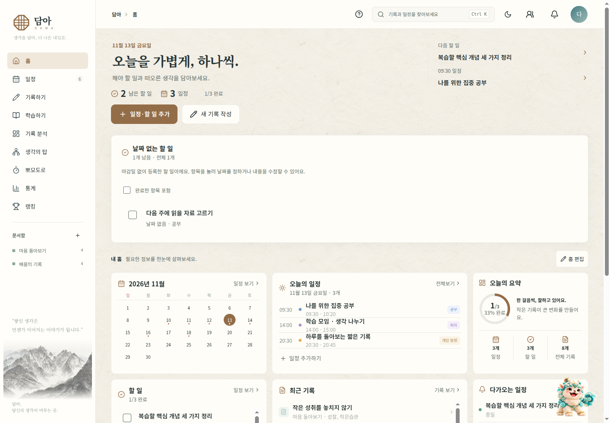

오늘 할 일과 일정을 확인하고 기록을 이어 씁니다. 아래에는 날짜 없는 할 일도 별도 목록으로 확인할 수 있습니다.

### 월간 일정

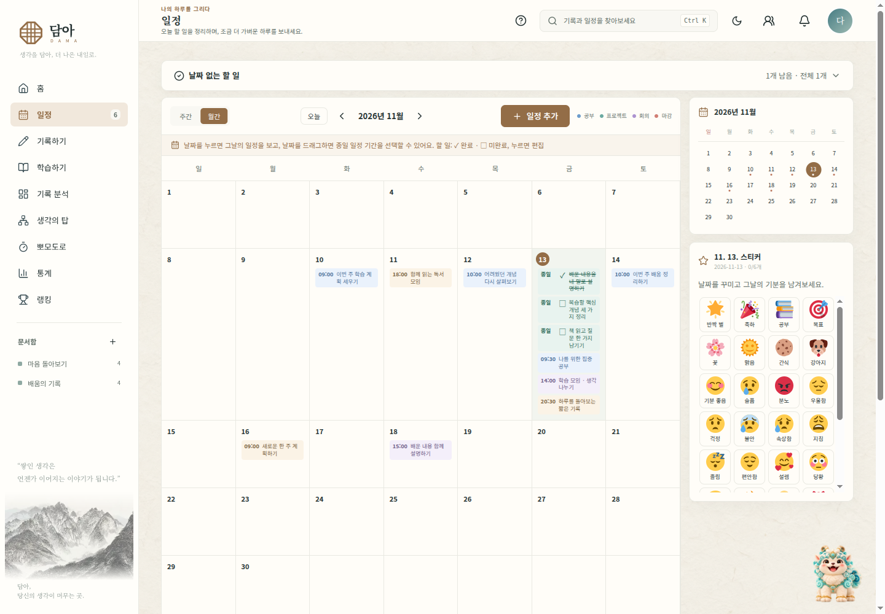

월 전체 계획에서 날짜를 고르고 그날의 일정·할 일을 살펴봅니다.

### 주간 일정

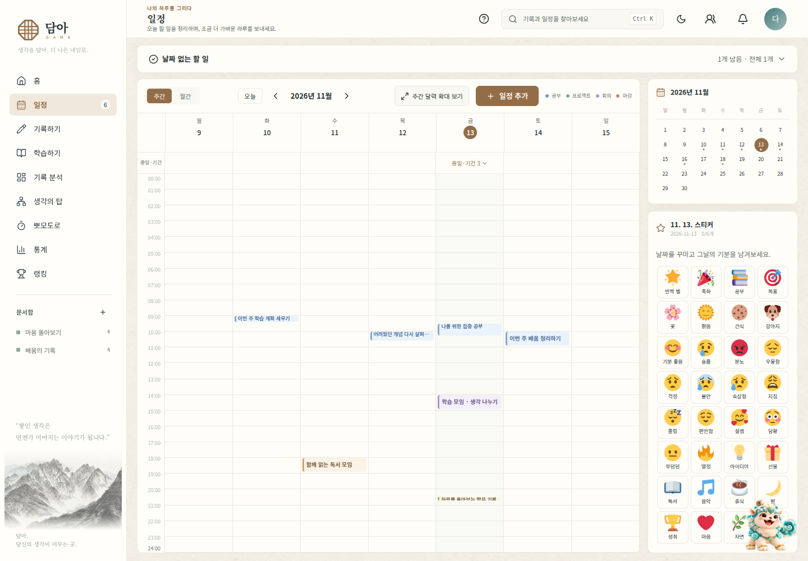

시간이 정해진 일정을 주간 시간표로 확인합니다. 날짜가 없는 할 일은 별도 목록에서 관리합니다.

## 기록과 질문

### 자신의 말로 남기는 기록

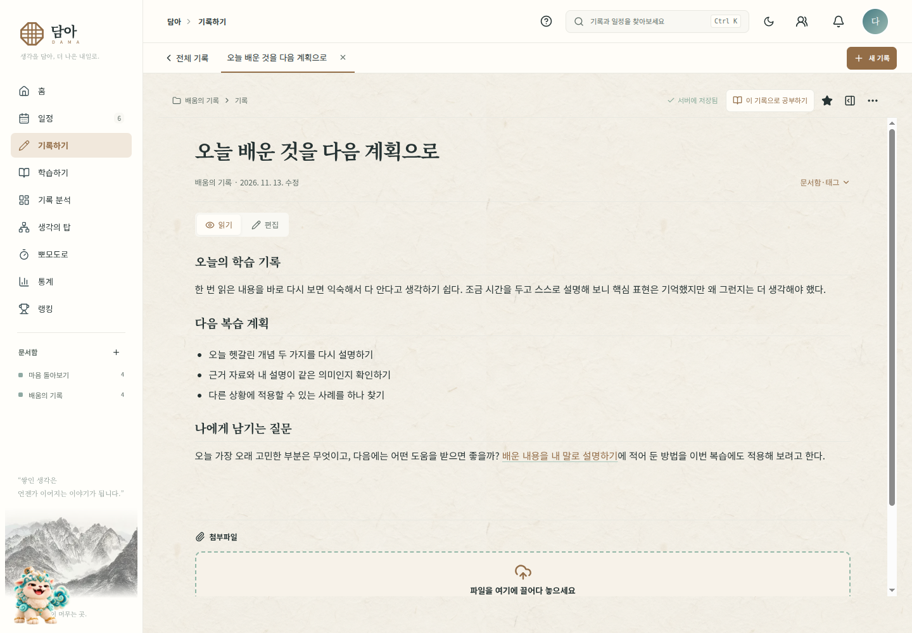

학습 노트와 일상 기록을 문서함에 정리하고, 저장한 기록을 다시 열어 읽거나 수정합니다.

### 질문을 읽고 생각을 기록하기

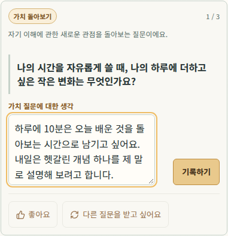

사진은 일반 사색 질문에 직접 예시 답변을 작성한 장면입니다. 답변은 자신의 기록으로 남길 수 있습니다. 본인 경험 기록을 참고하는 AI 역질문은 AI 이용 설정과 연결 상태에 따라 제공하며, 이 사진의 일반 질문과 구분합니다.

## 자료로 공부하기

### 범위와 문제 유형 정하기

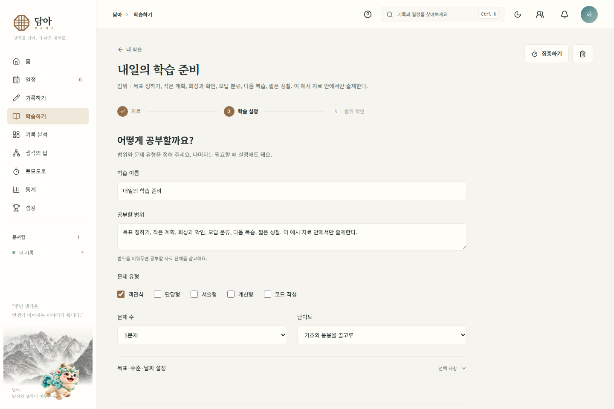

기존 기록이나 자료를 선택한 뒤 범위·수준·유형을 정합니다. 사진의 자료는 공개 시연을 위해 직접 작성한 ‘나의 학습 루틴’입니다.

### 한 문제와 원문 근거 확인

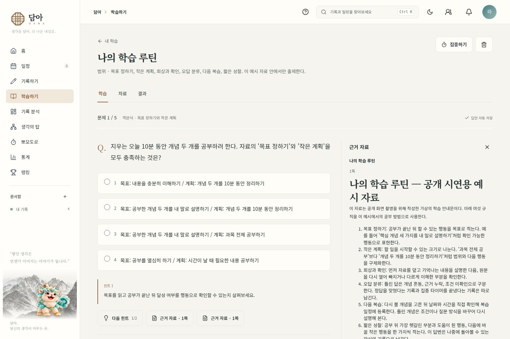

필요한 힌트와 근거를 펼쳐 자료와 문제를 함께 확인합니다. 정답과 해설은 답안을 제출한 뒤 표시합니다.

### 결과에서 다시 볼 내용 찾기

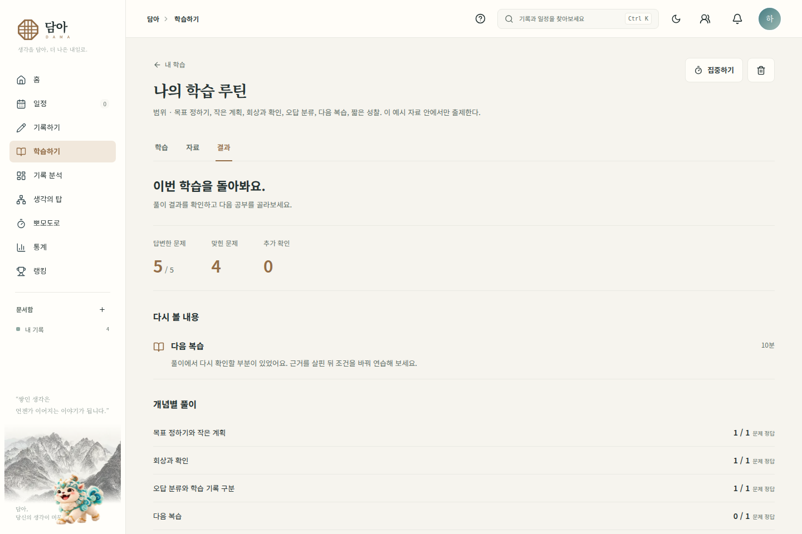

예시 답안 5개 중 4개는 정답, 1개는 오답으로 입력해 다시 살필 개념을 보여줍니다. 이 수치는 기능 시연을 위한 결과입니다.

### 확인한 복습 항목만 일정에 등록

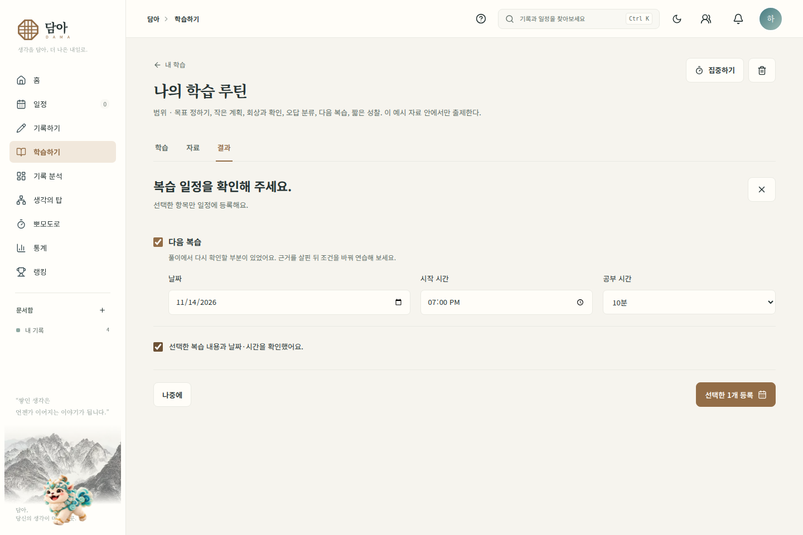

등록할 항목과 날짜·시간을 직접 확인합니다. 저장한 일정의 ‘공부 시작’에서 연결된 학습으로 돌아올 수 있습니다.

## 집중과 생각의 탑

### 야간 테마의 집중 타이머

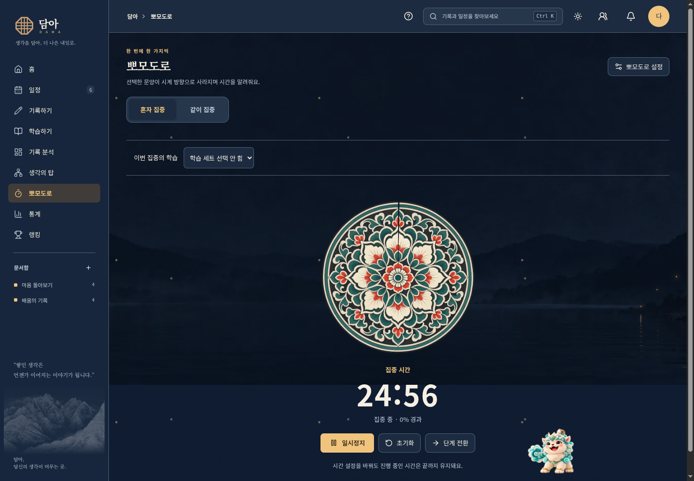

집중·휴식 시간을 정하고 타이머를 시작합니다. 타이머 완료와 문제 정답 여부는 별개로 기록합니다.

### 기록이 쌓이는 생각의 탑

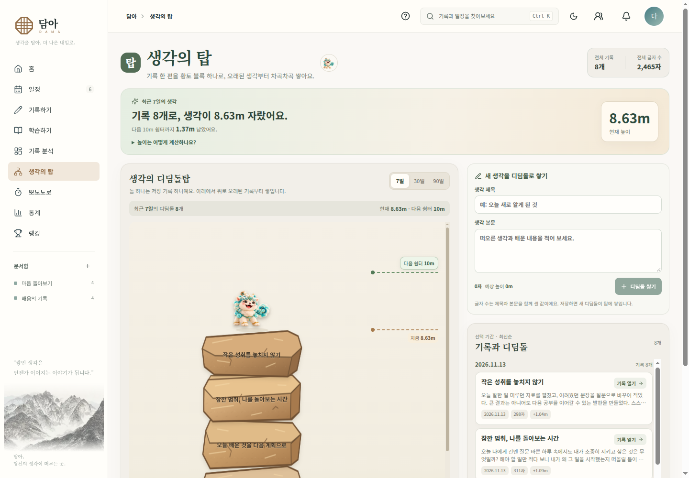

돌을 선택해 기록 원문을 확인하거나 편집 화면으로 이동합니다. 탑 높이와 예시 기록 수는 시연 데이터입니다.

## 모바일

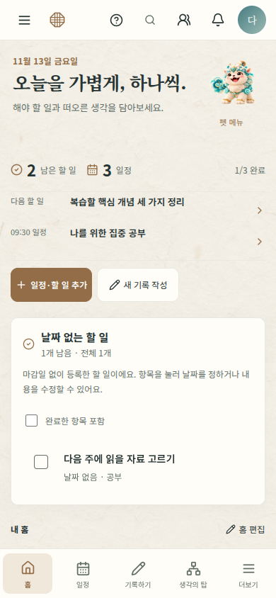

좁은 화면에서는 오늘의 계획과 하단 메뉴를 중심으로 이동합니다. ‘더보기’에서 학습하기와 다른 메뉴를 열 수 있습니다.
