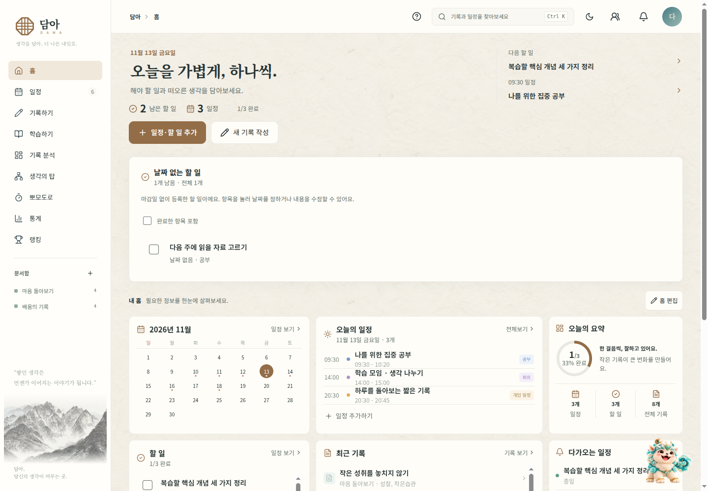
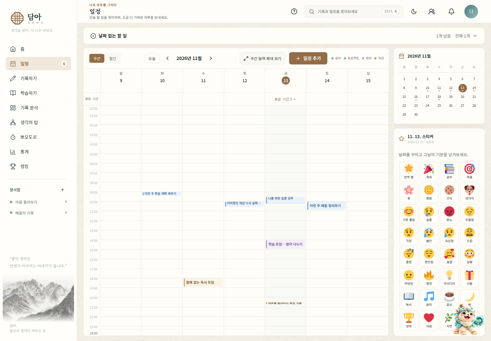
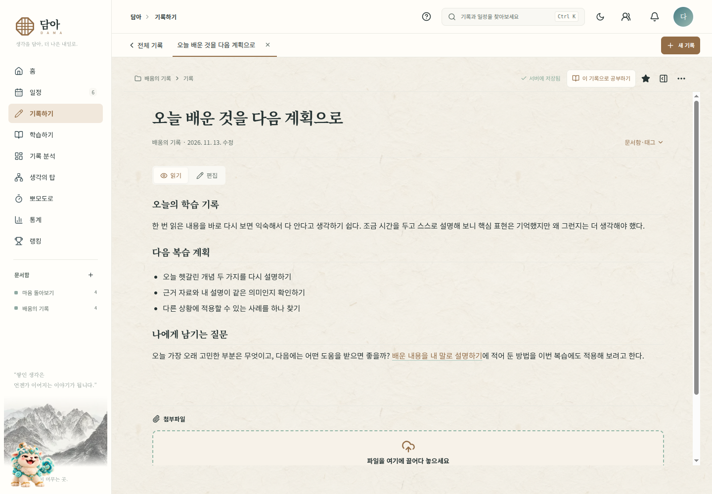
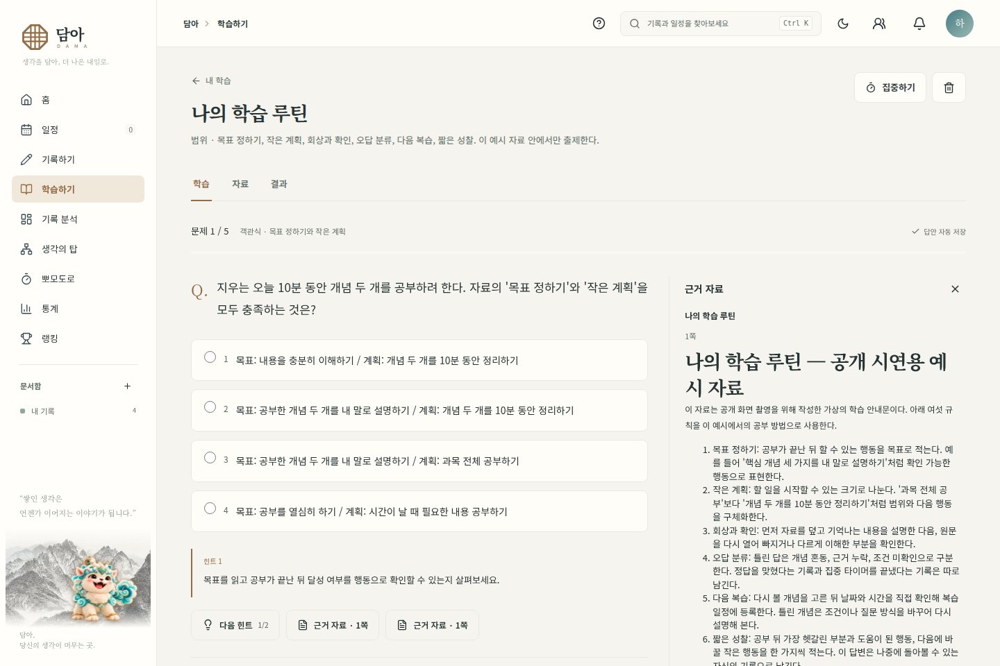
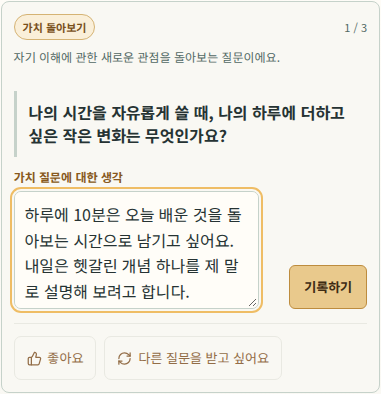
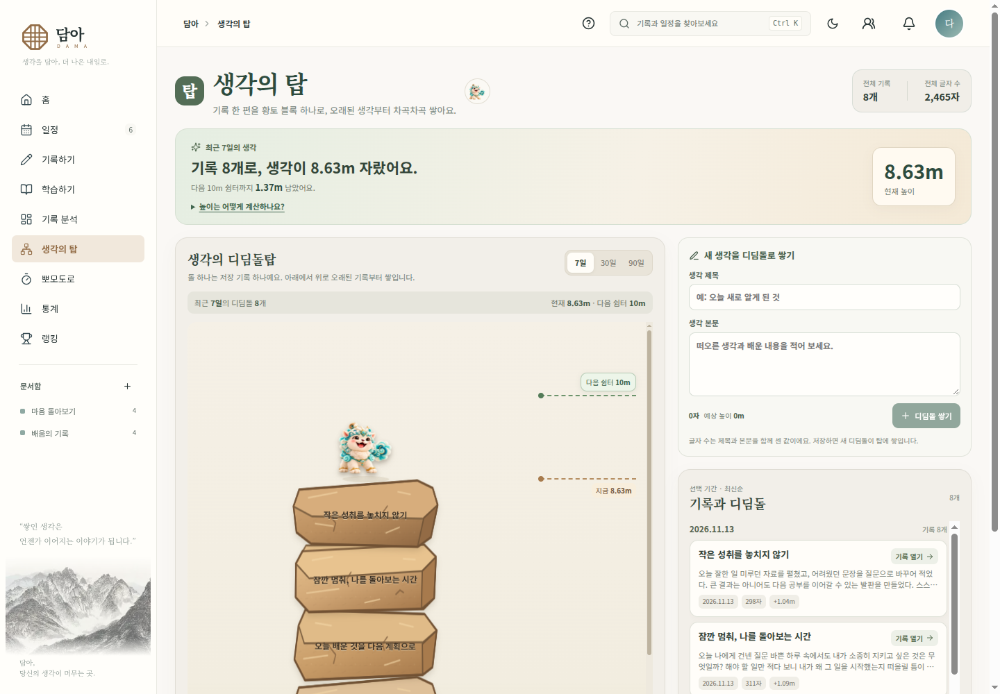
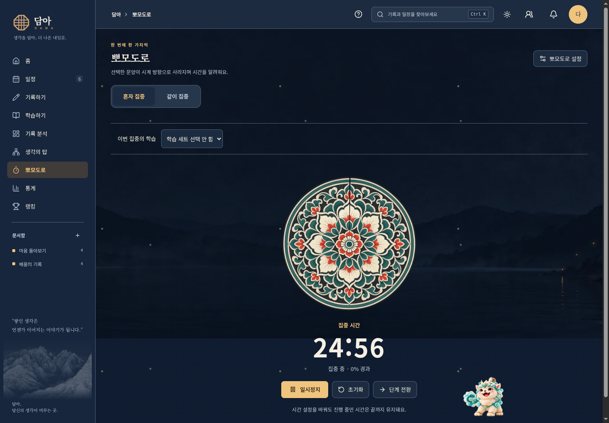

# 담아 사용 안내

사진은 **v4.40.1 · 2026-11-13**의 공개용 가상 데이터로 촬영했습니다. [전체 화면 모음](SCREENS.md)에서 기능별 사진을 볼 수 있습니다.

v4.40.5 기준 · 마지막 갱신 2026-11-14. 현재 앱에 적용된 버전은 **계정 및 설정 → 앱 정보**에서 확인하세요. 버전별 내용은 [업데이트 기록](../CHANGELOG.md)을 참고하세요.

## 학습 문제 생성이 오래 걸리거나 중단됐을 때

출제와 정답·근거 검토가 차례로 진행됩니다. 다른 화면으로 이동하거나 새로고침해도 진행 상태를 다시 확인할 수 있습니다. 실패 화면에 **저장된 단계부터 계속**이 있으면 이전 결과로 이어갑니다. 검토가 끝난 문제만 학습 화면에 표시합니다.

접수 결과를 확인하지 못했다는 안내가 나오면 자동으로 새 출제를 반복하지 않습니다. 새 작업은 중복 처리와 추가 비용이 발생할 수 있으므로 저장된 상태를 먼저 확인하세요. 복구용 입력과 중간 결과는 7일 후 만료해 정기적으로 삭제하며 학습 세트·계정 삭제 시 함께 삭제됩니다. 운영 백업 사본은 기존 보존 안내를 따릅니다. OpenAI는 상태 조회를 위해 응답을 약 10분 임시 보관하므로 무제한 복구를 보장하지 않습니다. 처리 시간은 자료·문항·모델 상황에 따라 달라집니다.

## 저장 오류 확인과 수정

다른 기록·일정·할 일의 저장이 실패해도 관계없는 새 일정과 할 일은 저장할 수 있습니다. **저장하지 못한 항목**에서 이름과 원인을 확인하고 **수정하기** 또는 **다시 저장**을 사용하세요. 다른 항목이 성공해도 남은 오류 안내는 유지됩니다. 다른 기기와 충돌한 항목은 **비교·해결**에서 내용을 고를 수 있습니다.

기록 저장 오류는 밝은 테마와 어두운 테마에서 읽기 쉽게 표시합니다. 같은 제목의 기록이 있으면 **제목 수정하기**로 제목 입력칸에 이동하고, 통신 오류라면 **다시 저장**을 누릅니다. 오류 설명과 해결 버튼을 함께 확인할 수 있으며, 수정·재시도 중에도 작성한 본문은 유지합니다.

일정에 연결한 기록이 아직 서버에 없으면 그 기록부터 저장해야 합니다. 이미 서버에 있는 기록의 미저장 편집은 일정 등록을 막지 않습니다. 저장 실패 시 현재 창의 입력은 유지되지만, 창을 닫거나 새로고침하면 일정 입력은 복구하지 않습니다. 필요한 내용을 먼저 복사해 보관하세요. 업데이트 뒤에는 담아 창을 모두 닫고 다시 열어 **계정 및 설정 → 앱 정보**에서 현재 버전을 확인하세요.

## 홈 구성하기

화면 예시 보기 · v4.40.1

사진 속 기록·일정·자료와 수치는 공개용 시연 예시입니다.

처음 홈을 열면 한국시간 기준 오늘의 달력·일정·할 일·요약을 표시합니다. 작은 달력에서 다른 날짜를 선택하면 다른 탭을 다녀오거나 홈·담아 로고를 다시 눌러도 선택한 날짜를 유지합니다. 오늘 내용을 보려면 작은 달력에서 오늘 날짜를 선택합니다. 주간·월간 달력에서 탐색하던 날짜는 별도로 유지됩니다.

홈의 **일정·할 일 추가**에서 직접 입력 또는 AI로 정리하기를 선택하고, **새 기록 작성**으로 기록을 시작할 수 있습니다. **다음 할 일**은 선택한 날짜의 첫 미완료 항목을 보여 줍니다. 누르면 상세 내용·연결된 기록을 확인하고 **완료하기**로 완료합니다. 내용을 바꾸려면 상세창의 **수정**을 선택합니다.

홈의 **오늘의 질문**에서 답을 쓰고 **기록하기**를 누르면 질문과 날짜를 제목으로 한 새 기록이 저장됩니다. 홈은 첫 미답변 질문을 보여 주고 기록 분석에서는 하루 세 질문과 답변 상태를 함께 확인합니다. 좋아요·질문 교체와 **질문 취향**의 설정은 같은 계정에 함께 반영됩니다. 일반 사색 질문과 수동 취향 설정은 AI 동의 없이도 이용할 수 있습니다. [자세한 질문 사용법](#기록-분석과-오늘의-질문)을 확인하세요. 날짜별 **오늘의 기록 열기**는 기존 일일 기록 편집기로 이어집니다.

홈의 **홈 편집**에서 카드 위치와 크기를 조절합니다. 데스크톱에서는 카드를 잡아 이동하고 오른쪽 아래 손잡이로 크기를 바꿉니다. 편집 내용을 확인한 뒤 완료해 저장합니다. 모바일에서는 한 열로 배치된 카드의 순서와 크기를 조절합니다.

목록형 할 일 카드는 해당 날짜의 모든 항목을 보여주고, 아래 공간이 비면 내용에 맞춰 늘어납니다. 아래에 다른 카드가 있으면 목록 내부를 스크롤해 나머지 항목을 확인합니다. 모바일 한 칸 크기는 목록 대신 요약을 표시합니다. 긴 제목은 카드 안에서 줄바꿈하며, 시간·종일 정보는 제목 아래에 표시합니다.

완료 수와 원형 게이지는 할 일에 지정한 날짜를 기준으로 합니다. 한 개 중 한 개 완료는 100%, 두 개 중 한 개는 50%이며, 항목이 없으면 **할 일 없음**입니다. 일반 일정은 완료할 일 수에 포함하지 않습니다. 달력과 홈에서 확인하는 같은 할 일의 완료 상태는 함께 반영됩니다.

## 날짜 없는 할 일 확인하기

각 항목의 **더보기(⋯)**에서 **날짜 지정·수정·삭제**를 선택할 수 있어요. 삭제할 때 항목 제목을 확인하고 취소할 수 있어요. AI 등록 결과의 **날짜 없는 할 일에서 보기**를 누르면 목록이 펼쳐지고 대상 항목이 강조돼요.

마감일 없이 등록한 할 일은 웹 홈과 일정의 **날짜 없는 할 일**에서 확인합니다. 홈에서는 목록이 바로 보이고, 일정에서는 해당 제목을 눌러 펼칩니다. 기존에 날짜 없이 저장한 항목도 이 목록에 표시하므로 같은 항목을 다시 등록할 필요가 없습니다.

- 항목의 제목을 누르면 내용을 수정하거나 날짜를 정할 수 있습니다. 제목만 수정하면 날짜 미지정을 유지합니다.
- 날짜를 정하면 해당 날짜의 목록과 달력으로 이동하고, 편집에서 날짜를 비우면 날짜 없는 목록으로 돌아옵니다. 시간은 날짜를 정한 뒤 추가할 수 있습니다.
- 체크 버튼으로 완료·완료 취소하고, **완료한 항목 포함**으로 완료한 항목도 확인합니다. 항목이 많으면 **모두 보기**로 펼칩니다.
- 날짜별 남은 할 일과 완료율에는 날짜 있는 항목만 포함합니다. 날짜 없는 목록의 전체·남은 개수는 따로 표시합니다.

이 목록과 날짜 미지정 편집 개선은 웹에 적용됩니다. Flutter 앱은 v4.38.1 버전 정보만 맞췄으며 새 설치 파일·스토어 출시는 별도입니다.

## 휴대폰에서 화면 이동하기

하단 메뉴로 주요 화면을 이동하고 **더보기**에서 기록 분석·뽀모도로·통계·랭킹 등을 엽니다. 메뉴는 화면 오른쪽의 고정된 위치에 짧게 페이드로 나타나고 배경이 어두워집니다. 나타나는 도중에도 버튼을 바로 선택할 수 있습니다. 닫기 버튼·배경 터치·Escape로 닫으면 원래 버튼으로 포커스가 돌아갑니다. 기기의 움직임 줄이기 설정에서는 즉시 전환합니다.

휴대폰 웹의 펫은 홈의 전용 자리에서 만납니다. 눌러 인사하거나 **펫 메뉴**에서 설정을 열고, 메시지 버튼으로 미읽음 내용을 확인합니다. 목록·작성 화면에서는 펫이 입력이나 저장 버튼을 덮지 않습니다. 휴대폰 펫 설정에서는 사용할 수 있는 설정을 먼저 보여 주며, 위치·크기·이동 등은 **PC에서 사용하는 설정**에 접어 둡니다. 컴퓨터의 이동·착지·설정은 기존대로 사용할 수 있습니다.

## 홈 위젯 자동 재배치

**홈 편집**에서 위젯을 옮기거나 오른쪽 아래 손잡이로 크기를 키우면 겹치는 주변 위젯이 아래로 비켜난다. 잡은 위젯의 위치와 크기를 우선하며, 주변 위젯의 크기는 유지한다. 영향을 받지 않는 위젯과 빈 공간은 최대한 유지한다.

- 이동·크기 조절 중 주변 위젯까지 포함한 전체 배치를 미리 보여준다. 놓으면 편집안에 반영하며 **되돌리기**로 마지막 편집을 한 번 취소할 수 있다. 드래그 도중 Esc를 누르면 해당 조작을 취소한다.
- **완료**를 누르면 홈 배치 전체를 저장한다. **취소**를 누르면 편집 전 배치로 돌아간다. 저장 오류가 나면 편집안을 유지해 다시 저장할 수 있다.
- 컴퓨터에서는 이동 손잡이에 키보드 초점을 둔 뒤 방향키로 이동하고 Shift+방향키로 크기를 조절할 수 있다. 이때도 주변 위젯이 자동으로 비켜난다.
- 편집 가능한 영역을 넘어서는 배치는 적용하지 않고 안내한다. 위젯을 더 위로 옮기거나 크기를 줄여 공간을 확보한다. 모바일은 기존 한 열의 순서·크기 편집을 사용하며 컴퓨터 배치와 별도로 저장한다.
- 위젯을 움직이거나 크기를 바꿔도 일정·기록·할 일 내용은 바뀌지 않는다. 공개 예시 화면(`?preview=1`)의 배치는 현재 화면에서 체험하며 새로고침하면 초기화된다.

## AI로 일정·할 일 추가하기

홈의 **일정·할 일 추가** 또는 일정 화면의 추가 버튼을 누른 뒤 **직접 일정 입력 / 직접 할 일 입력 / AI로 정리하기**를 고릅니다. 펫을 눌러 나타나는 AI 버튼도 같은 작성 흐름으로 연결됩니다. 기본은 빈 새 작성 화면입니다. PC는 옆 패널, 모바일 웹은 높은 하단 패널을 사용합니다. 창을 열었다 닫기만 하면 빈 서버 초안을 만들지 않으며, 첫 요청 전송이나 **직접 추가**를 할 때 보관을 시작합니다.

1. “내일 3시 회의 있고 금요일까지 보고서 제출해야 해”처럼 입력하면 일정·할 일을 카드로 나눕니다. 입력한 요청·대화와 현재 등록 초안을 AI로 전송하며, 기존 기록 본문을 검색하거나 전송하지 않습니다.
2. 필요한 질문에 자연어나 빠른 버튼으로 답합니다. 연도·날짜·요일·시각·종일·반복 시작/종료 조건을 확인합니다. 할 일의 마감일은 필수가 아니며, 장소·설명은 선택입니다.
3. **수정**을 펼쳐 값을 고치고 **카드 수정 반영하기**를 누릅니다. 체크를 끄면 이번 등록에서 제외합니다.
4. **일정 1개 · 할 일 1개 등록**처럼 종류와 개수를 표시한 버튼을 눌러야 실제 항목이 저장됩니다. “응”, “좋아”라는 답이나 창 닫기로는 등록되지 않습니다.
5. 처리 중이거나 요청·등록 결과를 확인하지 못한 경우에는 기존 요청 화면을 유지해 이어서 확인합니다. **이전 요청 다시 확인** 또는 **등록 결과 확인하기**를 사용하세요. 다른 곳에서 수정한 초안은 최신 카드를 다시 확인하며, AI 실패 시 기존 카드를 직접 수정하거나 다시 요청합니다.

웹은 등록한 실제 항목을 다시 조회해 확인한 뒤 완료를 표시합니다. **등록 결과 → 열기**로 저장한 일정·할 일을 바로 확인하고 수정할 수 있으며, 반복은 첫 회차 상세를 읽기 전용으로 엽니다. 마감일이 없는 항목은 [날짜 없는 할 일](#날짜-없는-할-일-확인하기)에서 확인합니다.

**저장 결과 확인이 필요해요**가 나오면 같은 항목을 새로 등록하지 말고 **저장 결과 다시 확인**을 누르세요. 저장은 확인됐지만 목록을 갱신하지 못했다면 **목록 다시 불러오기**로 조회만 재시도합니다. 미저장 일정·할 일이 있으면 먼저 저장한 뒤 목록을 다시 불러오세요. 결과 재확인과 목록 재조회는 새 등록을 만들지 않습니다.

이전에 작성한 내용은 접힌 **보관한 초안 N개**를 펼쳐 제목을 선택하면 대화·카드와 수정값을 이어 씁니다. 목록이 길면 **초안 더 보기**로 확인합니다. **새 계획 작성하기**는 기존 미완료 초안을 지우지 않고 빈 작성 화면을 엽니다.

날짜를 고쳐 달라고 요청하면 실제 반영된 날짜를 답변과 카드에서 확인합니다. 카드에는 **마감일: 11월 13일 → 11월 20일로 변경됨**처럼 바뀐 내용을 표시하며, 대상이나 날짜가 불명확하면 확인을 요청합니다. 새로 만든 날짜를 기존 날짜의 수정으로 표시하지 않습니다. 카드와 최종 등록에는 같은 초안 값을 사용하므로 등록 전에 연도·날짜·요일을 확인하세요.

다른 시간대의 시간 있는 항목은 담아에 표시될 서울 날짜·시각도 함께 확인합니다. 시간대 전환으로 없는/중복되는 시각이나 서울 날짜를 넘기는 시간 있는 할 일은 수정이 필요할 수 있습니다. 반복은 일·주·월·년 간격과 시작일·선택 종료일을 지원합니다. 조건 문구·장소·설명은 등록 원본 부가정보로 보존하며 일반 일정·할 일 상세에서 볼 수 있습니다. 별도 AI 알림 규칙은 추가하지 않습니다.

AI 해석 요청은 기본 계정별 하루 30회(서울 날짜 기준)이며 한도에 도달해도 직접 카드 수정과 유효한 초안 등록은 계속 사용할 수 있습니다. 기록 기반 **AI 질문** 켜기/끄기는 기록 분석 설정이며, 이 등록 기능은 별도로 요청을 보낼 때만 해당 요청과 초안을 전송합니다. 담아에 저장됐다는 안내는 외부 Google 캘린더 동기화 완료를 뜻하지 않습니다. 기존 연결 화면에서 동기화 상태를 확인해 주세요.

이번 v4.38.0 새 작성·보관 초안 UI는 웹·API 업데이트입니다. Flutter 앱은 이번 릴리스에서 버전 정보만 맞췄으며 기존 작성 흐름을 유지합니다. 새 설치 파일·스토어 출시는 별도입니다.

웹 입력창은 **Enter로 보내기 / Shift+Enter로 줄바꿈**을 지원합니다. 한글을 조합하는 Enter는 전송하지 않아요. 수업·현장실습처럼 문맥이 충분하면 오전·오후를 해석하고, 카드에 **문맥상 오후 2시(14:00)로 해석했어요**와 근거를 표시합니다. 맥락 없는 ‘내일2시’는 확인하며, 시각 자체가 없으면 임의의 시간을 만들지 않습니다. 카드에서 시간을 고치거나 ‘아니, 오전2시로’처럼 답할 수 있습니다. 직접 정한 시간은 다른 내용을 수정하는 대화에서도 유지합니다. 해석한 값은 최종 등록 전에 확인하세요.

### 말로 공동 일정 초대하기

웹 AI 작성 화면에 **“내일 오후 3시부터 4시 회의를 민수에게 공동일정으로 보내줘”**처럼 날짜·시간과 함께 초대할 친구 이름을 적습니다. 이 요청은 등록 전 초안을 만들며, 대화로 ‘보내줘’라고 말한 것만으로 초대를 전송하지 않습니다.

1. 카드의 **등록 범위**에서 **공동 일정 · 친구 초대**를 확인합니다.
2. **함께할 친구** 목록에서 실제 초대할 친구를 선택합니다. 같은 이름의 친구가 여러 명이거나 입력한 이름을 찾지 못하면 목록에서 직접 고릅니다.
3. 받는 친구와 일정 내용을 읽고 **위 친구들에게 초대할 내용을 확인했어요**를 체크한 뒤 **카드 수정 반영하기**를 누릅니다. 받는 사람이나 내용을 바꾸면 다시 확인합니다.
4. 마지막 **공동 일정 N개 초대** 버튼을 눌러야 공동 일정과 초대를 생성합니다. 결과의 초대 대상을 확인하고, 친구가 수락하면 그 친구의 달력에도 표시됩니다.

친구 초대는 현재 **반복 없는 일반 일정**만 지원합니다. 할 일이나 반복 항목의 초대 요청을 개인 등록으로 자동 변경하지 않으므로, 종류·반복 설정을 수정하거나 명시적으로 개인 등록을 선택하세요. 체험 화면은 실제 친구 초대를 보내지 않습니다. 이번 개선은 웹·API에 적용하며 Flutter의 새 설치 파일·스토어 출시는 별도입니다.

등록 결과의 **달력에서 보기**는 실제 저장 날짜로 월간·주간을 함께 맞춰 이동해요. 모바일에서 오늘 이외 날짜는 월간으로 열어요. 날짜 없는 항목은 **날짜 없는 할 일에서 보기**로 해당 목록을 바로 열어요. 등록 전에는 일정·날짜 있는 할 일·날짜 없는 할 일의 개수를 구분해서 확인할 수 있어요.

## 조작과 저장 상태 안내

버튼의 터치 잔물결과 체크 표시, 날짜·탭 선택 움직임으로 조작 결과를 확인합니다. 처음 나타나는 할 일 행에는 짧은 순차 표시를 사용하고, 실제 검색 대기가 있을 때만 자리표시자 위 빛 흐름을 보여줍니다. 기기의 움직임 줄이기 설정에서는 움직임을 줄입니다. 할 일 완료의 **실행 취소**는 8초 동안 제공하며, 저장 실패 시 체크와 완료율을 복구하고 **다시 저장**을 지원합니다.

## 일정과 할 일 등록하기

일정과 할 일에는 각각 분류를 붙일 수 있습니다. 일정은 회의·업무·공부·약속·건강·운동·개인 일정·기타, 할 일은 업무·공부·프로젝트·생활·자기관리·기타 중에서 고릅니다. **기타**의 이름은 직접 입력할 수 있으며 최대 40자입니다. 입력하지 않으면 기타로 표시됩니다. 등록 후 수정창에서도 분류를 바꿀 수 있습니다.

1. 홈의 **일정·할 일 추가** 또는 달력의 추가 버튼에서 **직접 일정 입력 / 직접 할 일 입력**을 고릅니다. 홈에서 선택한 날짜는 등록창에도 이어집니다.
2. 시간칸을 누르거나 드래그해 등록창을 엽니다. 모바일은 시간칸을 누르고, 키보드는 방향키로 선택한 뒤 Enter로 엽니다. 달력의 추가 버튼에서도 등록할 수 있습니다.
3. 등록창의 **종류**에서 일정과 할 일을 고릅니다. 할 일은 미완료로 등록하며, 일반 일정은 할 일 완료율 집계에 포함하지 않습니다.
4. **종일**을 선택하면 시간 없는 항목으로, 선택하지 않으면 시작·종료 시간이 있는 항목으로 저장합니다. 완료 여부는 할 일에서만 체크합니다. 일반 일정에는 완료 체크가 없습니다.

휴대폰 웹의 등록창은 가용 화면의 약 88% 높이로 열립니다. 키보드가 열리거나 가로 화면처럼 높이가 짧으면 가용 높이에 맞춥니다. 제목·날짜·시간을 먼저 입력하고 **추가 설정**을 펼쳐 스티커와 연결할 기록을 고릅니다. 창 제목과 아래 저장 버튼은 고정되고 입력 영역만 스크롤합니다. 추가 설정을 접어도 선택한 값은 유지합니다.

시작·종료 시간은 `HH:mm`으로 직접 입력하거나 시계 버튼으로 고릅니다. 휴대폰에서는 별도의 시간 선택창이 열려 시·분 목록을 스크롤할 수 있습니다. 1분 단위를 지원하며 종료 시간은 시작보다 늦어야 합니다. **선택 완료**, 닫기·배경 터치·Escape는 시간 선택창을 닫고 기존 입력창으로 돌아갑니다. 등록창의 **추가하기/저장**을 눌러야 일정이 저장됩니다.

여러 날짜를 할 일로 등록하면 날짜별로 독립적인 항목이 만들어집니다. 저장 전 날짜별 등록 안내를 확인하세요. 저장 오류가 나면 남아 있는 입력에서 **다시 저장**을 누릅니다. 같은 등록의 재시도로 항목이 중복 생성되지 않습니다. 기존 할 일과 개인 일정은 편집창에서 종류를 전환할 수 있습니다.

## 일정·할 일 입력과 저장

직접 등록·수정창의 입력은 기기 초안으로 보관하지 않습니다. AI 등록의 서버 초안은 위의 별도 흐름을 따릅니다. **추가하기/저장**을 눌러 등록하고 성공 여부를 확인하세요. 저장 전 창을 닫거나 새로고침하면 입력을 다시 불러오지 않으며 상단의 초안 확인·접기 안내도 표시하지 않습니다. 이전 버전의 기기 초안도 읽거나 자동 복구하지 않습니다.

저장에 실패하면 현재 작성창의 입력을 유지해 다시 시도할 수 있습니다. 저장 응답을 받지 못한 경우 같은 창에서는 같은 요청 식별자로 재시도해 중복 생성을 방지합니다. 메모 자동 저장과 관리자 초안은 별도 기능으로 유지합니다.

## 월간·주간 일정 사용하기

화면 예시 보기 · v4.40.1

사진 속 기록·일정·자료와 수치는 공개용 시연 예시입니다.

- 컴퓨터에서는 월간·주간 달력의 **개인 일정**을 우클릭한 채 다른 날짜 칸으로 끌어 놓아 복사할 수 있습니다. 여러 일정을 함께 복사하려면 각 일정에서 **Shift+우클릭**으로 선택한 뒤 선택된 일정 하나를 우클릭 드래그합니다. 날짜 사이의 간격과 일정 기간은 유지되고 원본도 남습니다. 주간 시간 칸에 놓으면 시작 시각을 옮기고 소요 시간을 유지합니다. 복사할 날짜가 화면 밖이거나 날짜 칸 밖에 놓으면 전체 복사를 취소합니다. 공통 일정과 할 일은 이 조작의 대상이 아닙니다.
- **월간**에서는 날짜를 선택해 상세 내용을 확인합니다. 데스크톱에서 날짜 범위를 드래그하면 기간이 입력된 종일 일정 등록창이 열립니다. 모바일·키보드 사용자는 등록창의 시작일·종료일로 기간을 지정합니다.
- **주간**에서는 시간이 있는 항목을 시간표에서 관리합니다. 시간 없는 항목은 날짜 헤더 아래 **종일·기간**에 표시합니다.
- 컴퓨터의 주간 시간표에서 개인 일정·할 일 카드의 **위쪽 가장자리**를 드래그하면 시작 시간, **아래쪽 가장자리**를 드래그하면 종료 시간을 바꿀 수 있습니다. 5분 단위로 조절하며 Esc로 취소합니다. 종일·여러 날·공통 일정과 모바일·키보드는 기존 편집창에서 시간을 수정합니다.
- 종일·기간 항목은 날짜별 2개를 먼저 보여주며 **더 보기**로 나머지를 확인·편집합니다. 영역을 접으면 날짜별 건수의 한 줄 요약으로 바뀝니다.
- 시간표는 하루 전체를 촘촘하게 표시합니다. **주간 달력 확대 보기**로 주변 설명·카드를 접으면 시간표를 더 넓게 볼 수 있습니다. 확대를 종료해도 보고 있던 날짜와 시간표 위치를 유지합니다.
- 월간·주간은 각자의 탐색 날짜를 기억하며, 같은 일정·할 일을 함께 표시합니다. 월간의 완료한 할 일은 **✓와 제목 취소선**, 미완료는 **□**입니다. 아이콘이나 제목을 누르면 편집창이 열립니다.

휴대폰의 **일정** 탭에서는 오늘의 일정과 할 일을 시간 순서의 목록으로 볼 수 있습니다. 큰 화면에서는 주간 시간표를 계속 사용할 수 있습니다. 휴대폰 월간 화면은 7열 달력에서 날짜를 누르면 그날의 상세 목록으로 이동합니다. 목록의 항목을 눌러 상세 내용을 확인하고, **달력 보기**로 날짜 선택 영역에 돌아갑니다. 기기의 움직임 줄이기 설정을 반영하며, 날짜 선택만으로 편집창을 열지는 않습니다.

## 업데이트 안내와 Google 할 일 승인

앱의 새 버전 안내에서 **업데이트 내역 보기**를 누르면 연동 방법을 읽을 수 있습니다. 닫은 뒤에도 **계정 및 설정 → 앱 정보 → 업데이트 내역**에서 다시 확인합니다.

**계정 및 설정 → 데이터 관리 → Google 캘린더·할 일 연동**에서 Google 계정을 연결하고 가져올 캘린더를 선택해 저장하세요. 기존 캘린더 연결에는 접속·앱 복귀 시 변경 확인이 적용됩니다. Google 할 일은 같은 화면의 **Google Tasks 권한 추가 승인**을 한 번 진행해야 가져옵니다. 캘린더가 연동됨으로 표시되어도 Tasks 읽기 권한은 별도로 필요합니다. 날짜가 있으면 종일 항목으로, 날짜가 없으면 할 일 목록에 표시됩니다. Google Tasks API는 예약 시각을 제공하지 않습니다.

## Google 로그인과 캘린더 연결

로그인 화면의 **Google로 계속하기**를 사용합니다. 기존 DAMA 계정은 아이디로 로그인한 뒤 **계정 및 설정 → 내 정보 → Google 로그인 연결**에서 현재 비밀번호를 확인하고 연결하세요. 이메일이 같다는 이유로 계정을 자동 병합하지 않습니다. Google 전용 계정에서 비밀번호가 필요한 기능은 비밀번호 찾기로 먼저 설정할 수 있습니다.

Google 로그인과 캘린더 권한 승인은 별개입니다. **계정 및 설정 → 데이터 관리 → Google 캘린더·할 일 연동**에서 안내를 읽고 Google 권한을 허용하세요.

- 새 연결은 쓰기 가능한 기본 캘린더와 자동 동기화를 시작합니다. 과거 1년~미래 2년의 개인 일정·수락한 공유 일정·날짜 있는 할 일을 Google의 일반 일정으로 등록합니다.
- 기존 연결의 미연결 항목 자동 등록은 안내를 확인하고 Google 연결을 다시 승인한 뒤 시작됩니다.
- **Google Tasks 권한 추가 승인**을 허용하면 모든 Google 할 일 목록을 담아 할 일로 가져옵니다. 날짜·완료도 반영하며 Tasks는 가져오기 전용입니다. Google API는 예약 시각을 제공하지 않아 날짜 있는 종일 할 일로 표시하고 날짜 없는 항목도 가져옵니다.
- 가져온 Tasks를 Google 일반 일정으로 다시 보내지 않습니다. 담아에서 수정·삭제한 사본은 보존하고 충돌 건수를 알리며, Google에서 삭제해도 담아 사본은 남습니다.
- 읽기 전용 캘린더도 선택할 수 있습니다. 생일·집중 시간·부재중·근무 위치·Gmail 일정도 지원하며 읽기 전용·특수 항목의 Google 원본은 담아에서 변경하지 않습니다. 일반 일정 조회 범위는 과거 1년~미래 2년이고 구독 캘린더는 직접 선택해야 합니다.
- 담아 접속·창/앱 복귀·온라인 복구 시 변경 확인을 바로 요청합니다. 앱이 보이는 동안 약 30초마다 추가 확인합니다. 미저장 일정과 저장 중인 내용이 있으면 안전한 시점까지 보류하고 연속 요청은 합칩니다.
- Google 일반 일정은 변경 알림을 받아 동기화하며 연결 상태를 확인할 수 있습니다. 알림 누락과 앱 종료 중에는 기존 2분 주기로 보조 확인합니다. Google Tasks는 같은 변경 알림 기능이 없어 접속·복귀와 주기 조회를 사용합니다.
- 데이터 양·구글 응답·네트워크에 따라 반영이 지연될 수 있습니다. 즉시 완료나 일정한 지연 시간을 보장하지 않습니다.
- Google에서 개인 일정·할 일을 수정하면 원래 DAMA 항목에 반영합니다. 완료 상태·분류 같은 DAMA 고유 정보는 유지합니다. 날짜 없는 할 일은 발행하지 않습니다.
- 공유 일정 원본 수정은 주최자 권한을 따릅니다. 참여자의 Google 수정은 충돌로 보류하며 Google 사본 삭제가 공유 모임 전체 취소로 이어지지 않습니다.
- 동시에 수정했거나 원래 항목으로 표현할 수 없는 변경은 충돌 내용을 확인해 처리합니다. 개별 연결을 해제한 항목은 자동 재등록하지 않습니다.
- **지금 양방향 동기화**와 가져올 캘린더 선택을 사용할 수 있습니다. 자동 동기화를 중단하려면 **Google 연결 해제**를 선택하세요. 이미 저장된 양쪽 일정은 남습니다.

반복 일정은 각 회차를 가져오며 반복 규칙 전체를 편집하는 별도 화면은 제공하지 않습니다. 네이버 연동과 네이티브 앱 Google 로그인은 포함하지 않습니다. Google 민감 권한 검증이 완료되기 전에는 미검증 경고와 누적 사용자 제한이 남습니다.

## 주간 시간표 재배치

**일정 → 주간**에서 시간 지정 일정과 할 일을 삭제하지 않고 옮길 수 있다. 컴퓨터에서는 카드 본문을 드래그한다. 빈 시간에 놓으면 그 시간으로 이동하고, 다른 카드의 상단 삽입선에 놓으면 그 카드 앞에 들어간다. 이동 시간은 드래그할 때 30분 단위로 맞춘다. 카드 위에 별도 화살표 버튼은 표시하지 않는다.

- 옮기는 항목과 밀리는 항목의 소요시간은 유지한다. 겹치는 뒤 항목만 기존 순서대로 밀며, 충돌하지 않는 항목과 빈 시간은 유지한다. 원래 자리는 자동으로 당겨 채우지 않는다.
- 드래그하는 카드는 진한 실선과 그림자로 강조해 포인터를 따라 움직이고, 자동으로 밀리는 카드는 기존 색과 모양을 유지하며 부드럽게 이동한다. 점선은 놓을 자리 한 곳에 표시하고, 원래 자리에는 제목을 중복 표시하지 않는다. 도착 시각은 작은 시간 표시로 확인한다.
- 놓으면 최종 배치를 유지한 채 변경된 항목들을 한 번에 저장한다. 저장 안내가 나타나거나 완료되어도 시간표 전체 위치는 유지한다. 저장 후 **배치 되돌리기**로 직전 시간 변경 전체를 되돌릴 수 있다. 이후 다른 편집이 있었다면 최신 배치를 덮어쓰지 않고 안내한다.
- 기기의 **모션 줄이기** 설정에서는 카드가 이동하는 애니메이션을 생략하고 카드별 역할 구분은 유지한다.
- 모바일에서는 카드 본문을 쓸어 스크롤하고 카드를 길게 누르면 **시간표 재배치** 창을 연다. 짧게 누르면 기존 편집창을 연다. 키보드는 카드에 초점을 둔 뒤 Shift+Enter로 재배치 창을 연다. 창에서 시작 시간 또는 앞에 둘 일정을 고르고 미리보기를 확인한 뒤 **배치 저장**할 수 있다. 드래그는 Esc로 취소할 수 있다.
- 같은 날의 시간 지정 항목을 대상으로 한다. 종일·여러 날 일정은 이 자동 밀기의 대상이 아니다. 여러 날 일정과 충돌하거나 종료가 자정에 닿거나 넘으면 전체 이동을 적용하지 않는다.
- 저장 요청이 거부되면 기존 배치를 유지한다. 응답이 끊겨 저장 결과를 확인하지 못했거나 다른 기기에서 시간표가 변경됐다면 최신 일정을 확인하고 다시 배치한다. 일반 카드 클릭을 통한 제목·시간 수정도 사용할 수 있다.

## 기록 작성과 정리

화면 예시 보기 · v4.40.1

사진 속 기록·일정·자료와 수치는 공개용 시연 예시입니다.

**기록하기** 주요 탭을 누르면 전체 기록 목록으로 돌아와 기록을 검색하고 문서함·태그·즐겨찾기로 거를 수 있습니다. 기록을 선택하면 넓은 편집기로 이동하며, **전체 기록**으로 목록에 돌아옵니다. 홈의 최근 기록·검색 결과·연결된 기록처럼 특정 기록을 직접 선택하면 해당 기록을 엽니다. 열어 둔 기록 탭과 작성 내용은 유지하며, 편집기 상단 탭으로 전환하거나 닫을 수 있습니다. 휴대폰에서는 제목·날짜·상태를 구분해 목록을 훑어보고, 편집 화면의 문서함·태그는 제목 아래 요약행을 펼쳐 설정합니다. 공유·버전·삭제는 **기록 도구**에서 선택합니다.

**모든 태그**는 태그 필터입니다. **태그 모아보기**는 현재 문서함·즐겨찾기·검색 조건에 맞는 태그별 기록 수를 보여 줍니다. 태그를 골라도 다른 조회 조건은 유지하며, 선택한 태그 칩의 ×를 누르면 태그 조건만 해제합니다. 실제 태그 추가·삭제는 기록 편집기에서 합니다.

저장된 기록에는 첨부파일을 한 개 이상 끌어 놓거나 **파일 선택**에서 여러 파일을 선택할 수 있습니다. PNG·JPEG·PDF·UTF-8 텍스트·코드 파일을 지원하며 파일마다 최대 10MB입니다. 선택한 파일은 순서대로 업로드되며 실패한 파일은 이름과 사유를 표시합니다. 새 기록은 먼저 저장한 뒤 첨부할 수 있습니다.

## 자료로 공부하기

화면 예시 보기 · v4.40.1

사진 속 기록·일정·자료와 수치는 공개용 시연 예시입니다.

1. **학습하기 → 새 학습 만들기**에서 시작하거나 저장한 기록의 **이 기록으로 공부하기**를 누르세요.
2. 공부할 내용으로 PDF·UTF-8 TXT/MD·기존 기록·붙여넣은 텍스트를 추가하세요. 기출 자료는 별도로 **시험 유형 참고**를 골라 추가할 수 있어요.
3. 목표·수준·범위와 문제 유형을 정한 뒤 분석을 실행하세요. 시험일은 선택 사항이에요. 업로드만으로 AI 분석을 실행하지 않아요.
4. 분석된 범위와 근거를 확인한 뒤 문제 생성을 실행하세요. 한 번에 한 문제씩 풀고, 필요할 때 단계별 힌트와 자료 근거를 펼치세요.
5. 답안을 저장해 나중에 이어 풀 수 있어요. 제출 후 객관식의 정답·해설과 서술형 등의 평가를 확인하세요. 선택지별 설명을 펼치고 평가 기준을 항목별로 읽을 수 있어요. 판단이 애매한 답은 확인 필요로 표시해요.
6. 결과에서 다시 볼 개념을 연습하거나 **복습 일정**에서 날짜·시간과 항목을 확인해 등록하세요. 등록 전에는 달력에 저장되지 않아요. 같은 요청을 다시 확인해도 일정을 중복 등록하지 않아요.

자료 분석 중에는 **자료 내용 분석 → 출제 범위 확인**, 문제 생성 중에는 **문제 출제 → 정답·근거 검토**와 경과 시간을 표시해요. 분석 후에는 범위를 확인하고 문제 생성을 직접 시작해요. 화면을 이동하거나 새로고침해도 시작 시각은 유지돼요. **생성은 계속하고 목록으로**를 눌러 다른 학습을 확인할 수 있으며 목록의 진행 상태도 갱신돼요. 현재는 전체 문항을 함께 검토하므로 중간 문항 수나 퍼센트를 표시하지 않고, 검토가 끝난 문제를 제공해요.

홈의 학습 이어하기와 선택 가능한 **오늘의 학습** 위젯, 연결된 일정의 **공부 시작**, 뽀모도로의 학습 선택, 통계에서 같은 학습으로 돌아올 수 있어요. 새 문제를 만들어도 이전 풀이 이력은 남아요. 기록 기반 역질문·사색 질문은 기존대로 사용할 수 있어요.

자료는 파일당10MB, PDF80쪽, 학습 세트당6개·합계30MB까지 지원해요. 스캔 PDF·암호 PDF·본문을 읽을 수 없는 파일은 변환한 뒤 올려 주세요. 세트별 본문 크기 제한도 있어요. 기본 AI 요청 한도는 계정별 하루20회이며 분석1회·출제와별도검토2회·비객관식평가1회로 계산해요.

선택한 자료·범위·풀이 답안은 해당 AI 작업을 위해 제공자에게 전송돼요. 자료 분석·출제·검토는 상태를 다시 확인하기 위해 제공자가 응답을 일시 보관해요. 담아의 복구용 입력과 중간 결과는 생성 7일 후 만료하며, 저장한 학습 세트·자료·풀이 이력의 보관과는 구분돼요. AI 문제와 평가는 오류가 있을 수 있으니 근거와 비교하고 문제 오류 신고를 이용하세요. 오류 신고 문항은 오답으로 집계하지 않아요. 출석·집중 시간·할 일 완료와 문제 이해도는 따로 표시해요.

학습은 계정에 저장되지만 **현재 계정 데이터 내보내기/가져오기 파일에는 새 학습 세트·자료·답안이 포함되지 않아요.** 계정 탈퇴 시 학습 데이터도 삭제되며 첨부 파일은 삭제 작업으로 정리해요.

## 기록 분석과 오늘의 질문

화면 예시 보기 · v4.40.1

사진 속 기록·일정·자료와 수치는 공개용 시연 예시입니다.

**기록 분석**에서 최근 **7일·30일·90일**을 선택하면 개인 일정 등록 수·할 일 완료율과 **요일별 기록 시간대**가 함께 바뀝니다. 시간표는 한국 시간의 처음 작성한 시각을 월요일~일요일과 새벽(00~06시)·아침(06~12시)·오후(12~18시)·저녁(18~24시)로 나눕니다. 칸을 누르거나 키보드로 선택하면 시간별 건수와 기록 목록을 확인합니다. 수정 횟수를 세지 않으며, 작성 시각이 없는 기록과 정상 0건을 구별합니다. 예전 기록 추이·태그/키워드·기록 활동 달력·활동 요약 박스는 이 시간표로 바뀌었습니다.

일정은 선택 기간에 걸친 개인 일정의 **등록 건수**입니다. 원형 그래프는 그 기간에 기한이 있는 **할 일의 완료율**이며, 할 일이 없으면 **할 일 없음**을 표시합니다. 공유 일정·반복 가상 일정·기한 없는 할 일은 제외합니다. 일정·할 일은 AI 질문의 입력 자료에 사용하지 않습니다.

**오늘의 질문**은 **자기 이해·관계·습관과 성장·진로와 배움·상상과 관점 전환**의 다섯 주제에서 하루 세 개를 준비합니다. 시험처럼 지식을 확인하기보다 사용자가 자신을 돌아보고 새로운 관점을 생각하도록 질문합니다. 개인 경험이 담긴 기록이 있고 AI 사용 설정이 켜져 있으면 기록을 소재로 쓸 수 있습니다. 강의 정리·참고자료·코드만 있는 기록은 보수적으로 제외하고 일반 사색 질문을 제공합니다. 이 구분은 완벽하지 않아 모호한 경험도 일반 질문으로 대체될 수 있습니다.

답변 칸에 글을 적고 **기록하기**를 누르면 질문과 날짜를 제목으로, 답을 본문으로 하는 기록이 저장됩니다. 홈은 첫 미답변 질문을 보여 주고 저장하면 다음 질문으로 넘어갑니다. 하루 세 질문 사이에 대기 시간은 없습니다. 이미 준비된 오늘 질문은 고정되며 취향 설정은 다음에 준비할 질문부터 반영됩니다.

### 질문에 반응하기

답변 내용과 질문에 대한 반응은 따로 관리합니다. **좋아요**는 마음에 든 질문을 표시합니다. **다른 질문을 받고 싶어요**에서는 이유 없이 바꾸거나 다음 중 하나를 고를 수 있습니다.

- 공부나 시험처럼 느껴져요
- 너무 무겁거나 부담스러워요
- 비슷한 질문을 많이 받았어요
- 관심 없는 주제예요

‘시험처럼 느껴져요’는 배움이라는 주제를 싫어한다는 뜻으로 처리하지 않습니다. ‘너무 무거워요’는 질문 깊이를 가볍게 바꿉니다. 단순히 답하지 않은 것을 불호로 판단하지 않습니다. 교체는 하루 다섯 번까지이며, 작성 중인 답변을 비우기 전에 확인합니다. 실패하거나 취소하면 입력을 보존합니다. 이미 답변했거나 기록 저장 후 질문 연결을 다시 시도하는 중인 질문은 바꿀 수 없습니다.

### 질문 취향 설정하기

홈이나 기록 분석의 **질문 취향**에서 관심 주제를 여러 개 고르고 **가볍게 생각하기 / 깊이 돌아보기**를 선택한 뒤 **취향 저장**을 누릅니다. 설정이 긴 홈 카드에서는 카드 안을 스크롤해 저장 버튼으로 이동합니다. 같은 계정의 홈과 기록 분석에 함께 반영됩니다.

표시된 비중은 직접 고른 주제·명시적 반응·답변 완료 여부를 참고한 추천값이며, 성격검사나 다른 사람과 비교한 성향 점수가 아닙니다. 사색 답변의 문장으로 질문 방식에 대한 불만이나 성격을 추측하지 않습니다. 관심이 한쪽에 모여도 다른 관점의 질문을 함께 준비하며 표시 비중과 실제 노출 비율이 정확히 같지는 않습니다. 기능 사용 전의 답변을 추천 점수에 소급하지 않습니다.

**취향 초기화**는 선택한 취향과 질문 반응·AI 조정값을 지우며 작성한 답변 기록을 지우지 않습니다. 초기화해도 하루 질문 교체 한도가 새로 생기지는 않습니다.

### AI 기본 사용과 전송 안내

AI 질문은 모든 회원에게 **기본 사용**으로 제공하며 별도 동의 체크는 없습니다. 설정은 계정 단위로 다른 클라이언트의 기록 처리에도 적용되며, 현재 켜기·끄기는 웹의 홈·기록 분석에서 변경합니다. 이전에 직접 AI를 꺼 둔 회원은 꺼짐을 유지합니다. 홈의 **AI 사용 설정**에서 기록 분석의 **AI에게 분석 질문하기** 창에서 **AI 질문 켜기/끄기**를 선택할 수 있습니다. 오늘의 질문 카드 본문에는 설정 안내 영역을 표시하지 않습니다. 홈에서 작성 중인 답변이 있으면 설정으로 이동하기 전 입력을 비울지 확인합니다. 기록 기반 질문에 저장 전 답변이 있을 때는 **계속 작성 / 입력 비우고 AI 끄기**로 확인합니다. 취소·실패 시 입력은 유지되고 성공한 뒤 확인한 기록 기반 입력만 비웁니다. 일반 사색 질문의 입력과 저장한 답변 기록은 유지됩니다. 일반 사색 질문·수동 취향·답변 저장은 AI를 꺼도 이용할 수 있습니다. 서버 연결이 아직 준비되지 않았다면 **AI 연결 준비 중**으로 표시하고 일반 사색 질문을 제공합니다.

AI 사용 시 검색용 임베딩을 만들기 위해 본인 계정의 활성 기록 제목·태그와 본문 최대 1,200자를 OpenAI로 보냅니다. 질문 생성과 기록 답변에는 선택된 기록 본문 일부(기록당 최대 700자)와 질문을 사용하며, 사색 질문을 생성할 때는 선택한 주제·깊이·최근 질문과 직접 남긴 질문 반응도 보냅니다. 첨부파일·일정·다른 계정 기록은 사용하지 않습니다. AI 비중 조정은 직접 남긴 반응을 근거로 작은 범위에서 제안하며 서버가 근거·한도를 확인합니다. 별도의 비중 조정용 AI 요청은 발생하지 않습니다.

기존 활성 기록의 색인은 해당 계정에서 AI를 처음 이용할 때 작업 대기열에 한 번 등록해 비동기로 처리합니다. 모든 회원의 과거 기록을 배포 순간에 일괄 전송하지 않습니다. 이미 준비된 오늘 질문은 유지되므로 AI를 다시 켠 뒤 기록을 참고한 질문이 다음 날부터 나타날 수 있습니다.

입력은 기본적으로 모델 학습에 쓰이지 않지만 제공자의 오남용 감시를 위해 최대 30일 보관될 수 있습니다. 담아는 `store:false`를 사용하지만 제공자의 오남용 감시 보관을 끄는 설정은 아닙니다. **내 기록에 질문하기**는 하루 최대 10회이며 답변과 참고 기록을 함께 보여 줍니다. 기록에 없는 내용은 틀릴 수 있으므로 근거 기록을 확인하세요.

AI 사용을 끄면 담아의 기록 기반 생성 문구·출처·사용량·검색용 임베딩과 AI 비중 조정을 삭제하고 이후 기록 기반 AI 요청을 중단합니다. AI로 일정·할 일을 정리하는 명시적 요청은 위의 별도 등록 안내를 따릅니다. 일반 질문·직접 고른 취향과 질문 반응·작성한 답변 기록은 남습니다. 사용자가 작성한 노트는 임의로 수정하지 않습니다. 제공자 측 보관은 제공자 정책을 따릅니다.

기록 본문의 `[[기록 제목]]` 연결은 계속 사용할 수 있습니다. 별도의 **지식 지도** 메뉴는 제공하지 않습니다.

## 생각의 탑

화면 예시 보기 · v4.40.1

사진 속 기록·일정·자료와 수치는 공개용 시연 예시입니다.

**생각의 탑**에서 저장한 기록을 돌블록으로 쌓아 보고 높이와 다음 쉼터를 확인합니다. 오래된 기록이 아래, 최신 기록이 위에 놓이며 꼭대기에는 선택한 펫의 종류와 색상이 표시됩니다. 돌을 누르면 기록 카드에서 제목·날짜·글자 수와 원문을 펼칩니다. 같은 돌을 다시 누르면 접고 **기록 열기**로 기존 편집 화면을 엽니다. 휴대폰에서는 탑·입력 폼·기록 목록 순서로 표시합니다.

## 활동 통계와 출석

**통계**에서 최근 365일의 활동을 봅니다. 오른쪽 연도로 과거 한 해를 선택하고 **최근 1년**으로 돌아옵니다. 모바일에서는 연도를 위쪽에서 고르며 잔디 영역만 좌우로 스크롤합니다. 조회는 한국시간의 오늘까지입니다.

- **출석**: 로그인한 화면을 전경에서 이용한 날에 하루 한 번 기록합니다. 같은 날 새로고침·다른 기기 접속으로 중복되지 않으며, 백그라운드 자동 조회만으로 늘어나지 않습니다.
- **출석 요약**: 오늘 기준 현재 연속 출석과 선택 기간 안의 최장 연속 출석입니다. 오늘 아직 이용하지 않았다면 어제까지의 연속 출석을 유지합니다.
- **등록 활동 잔디**: 할 일을 실제로 새로 저장한 날짜에 등록량을 쌓습니다. 오늘 다음 주 할 일을 10개 만들면 오늘 10건입니다. 수정·날짜 이동·재시도·완료 취소와 재완료는 건수를 늘리지 않습니다. 삭제해도 과거 등록 활동은 남습니다.
- **날짜 상세**: 잔디의 색이 등록량을 나타냅니다. 날짜에 마우스를 올리거나 키보드로 이동하고, 모바일에서는 날짜를 눌러 건수·출석을 툴팁으로 확인합니다. 방향키 위·아래는 하루, 왼쪽·오른쪽은 한 주씩 이동합니다.

**나의 활동 능력치**는 다음 실제 비율을 오각형으로 보여줍니다. 임의의 평가 점수나 종합 레벨은 아닙니다.

| 항목 | 비율의 기준 |
| --- | --- |
| 출석 | 출석한 날 / 집계일 |
| 꾸준함 | 최장 연속 출석일 / 집계일 |
| 계획 | 할 일을 등록한 날 / 집계일 |
| 실행 | 완료한 할 일 / 기간 내 할 일 |
| 기록 | 기록을 작성한 날 / 집계일 |

집계일은 선택 기간 중 활동 수집을 시작한 날 이후입니다. 수집 전 출석·등록량은 기존 할 일에서 추정해 채우지 않으며, 잔디에서 수집 전 날짜를 구분합니다. 기록 작성일은 현재 보관 중인 기록을 기준으로 하므로 삭제하면 달라질 수 있습니다. 자료가 없으면 **집계 없음**으로 표시합니다. 집중 시간 누적은 현재 통계에 포함하지 않습니다. 미리보기의 예시 활동은 실제 계정 이력이 아닙니다.

## 배지 보관함

웹의 **계정 및 설정 → 배지 보관함**에서 획득한 배지와 진행률을 확인할 수 있습니다. 획득한 배지는 마우스나 손가락으로 돌려 보고 대표 배지로 설정할 수 있습니다. 배지 상세에서는 관련 활동을 확인하고 현재 열람 가능한 기록으로 이동합니다. 출석·응원·기록·일정·할 일 완료 활동으로 배지를 얻으며, 같은 활동을 삭제하고 다시 만들더라도 같은 횟수를 중복 계산하지 않습니다.

## 친구와 알림함

상단의 **두 사람 아이콘**에서 친구 목록을, 바로 옆 **종 아이콘**에서 알림함을 연다. 사이드바와 모바일 하단 메뉴는 기존 구성을 유지한다. PC에서는 오른쪽 패널, 모바일에서는 화면에 맞는 창을 사용한다. 좁은 화면의 테마 변경은 **계정 및 설정 → 설정**으로 옮겼다.

친구 목록과 **뽀모도로 → 같이 집중 → 초대할 친구**에서 온라인·오프라인 상태를 확인할 수 있습니다. 상태를 확인할 수 없으면 **확인 중**으로 표시합니다. 오프라인 친구에게도 초대할 수 있습니다.

- **친구 추가·요청**: 친구 추가에서 내 초대 코드나 링크를 복사하거나 상대 코드를 입력한다. 링크를 열어도 요청은 직접 보내야 하며 상대가 수락해야 연결된다. 요청에서 받은 요청 수락·거절과 보낸 요청 취소를 할 수 있다. 초대 코드를 새로 만들면 이전 코드로 새 요청을 보낼 수 없다. 친구와 대기 요청은 합해100명까지다.
- **응원·직접 답장**: 친구의 응원 버튼에서 기본 문구를 고르거나 **직접 쓰기**로 최대 100자를 입력한다. 스티커를 고르고 수신자와 내용을 확인한 뒤 전송한다. 받은 응원에는 기본 문구 또는 직접 입력한 답장을 보낼 수 있다. 한 친구에게는 한 시간에 5번까지 응원할 수 있다. 친구 관리의 응원 알림 끄기는 해태 안내만 끄며 받은 응원과 알림함은 유지한다. 친구 설정에서 해태의 전체 친구 소식 안내를 끌 수도 있다.
- **읽지 않은 메시지**: 응원·답장 한 개는 보낸 사람, 두 개 이상은 개수를 해태 옆 작은 말풍선으로 표시한다. 말풍선은 조작하지 않는 시간 5초 뒤 숫자 배지로 접혀 해태가 다시 움직인다. 접혀도 읽음 처리되지 않으며 메시지를 실제로 열거나 명시적으로 읽음 처리하기 전까지 배지가 남는다. 말풍선에 포인터를 올리거나 키보드 초점을 두면 접히지 않는다. 기록 작성·일정 드래그 중에는 안내를 미룬다. 친구 요청과 일정 초대는 종 알림함에서 별도로 확인하며, 해태를 숨겨도 알림함은 사용할 수 있다.
- **펫 방문**: 친구 설정에서 방문 받기를 켜면 친구가 현재 선택한 펫을 보낼 수 있다. 처음에는 꺼져 있다. 방문한 펫은 출발할 때의 종류·색상으로 화면 가장자리의 안전한 공간에서 잠깐 인사하고 돌아가며 **반갑게 맞이하기**로 반응할 수 있다. 방문 중에는 다른 친구에게 펫을 보낼 수 없다. 작성·저장·가림·수면 중에는 방문을 미루고, 화면에 없을 때 도착한 소식은 알림함에 남긴다. 방문 안내와 알림 읽음은 별개다.
- **공통 일정 초대**: 일정 등록에서 **친구 초대**를 켜고 최대 20명을 선택한다. 장소는 선택 입력이다. 친구는 **일정 초대**에서 내용을 확인해 수락·거절하며 수락한 일정만 자신의 달력에 나타난다. 주최자가 시간·내용을 수정하면 참여자에게 반영하고 변경을 알린다. 참여자는 참여를 취소할 수 있지만 완료 체크와 공통 시간 수정은 제공하지 않는다. 주최자가 취소하면 참여자의 달력에서도 사라진다. 각자 자신의 달력을 확인해 수락하며 개인 일정 충돌 여부는 상대에게 표시하지 않고 기존 일정을 자동으로 밀지 않는다. 공통 일정은 드래그 자동 재배치 대상에서 제외한다. 개인 일정에서 전환해도 연결된 개인 기록·첨부는 공유하지 않는다.
- **기록 공유**: 저장된 기록에서 친구에게 공유를 누르고 검색·체크박스로 최대 50명을 고른 뒤 내용 미리보기를 확인한다. 확인한 기록 버전이 바뀌면 다시 확인해야 한다. 공유 시점의 제목·본문만 읽기 전용으로 제공하고 첨부·HTML·이미지·링크 탐색·태그·버전 이력은 공유하지 않는다. 원본을 수정·삭제해도 공유본은 유지된다. 한 번에 보낸 기록은 친구 패널에서 묶어서 보고, 받은 사람별로 열람하거나 공유를 해제할 수 있다. 이미 보거나 캡처한 내용은 회수할 수 없다.
- **친구 삭제·차단**: 친구 관리에서 삭제·차단한다. 친구 연결을 해제하고 양쪽의 기존 공유 기록 열람 권한을 영구 회수한다. 다시 친구가 되어도 옛 공유 권한은 복원되지 않는다. 차단하면 추가 요청·응원·공유가 거절되며, 설정에서 차단을 해제해도 자동으로 친구가 되지 않는다.
- **알림함**: 전체/읽지 않음과 개별 읽음·모두 읽음을 제공한다. 종의 숫자는 읽지 않은 알림 수이고, 친구의 작은 점은 응답을 기다리는 요청이다. 알림을 읽어도 수락·거절 전까지 요청은 유지된다. 종료된 요청이나 회수된 공유는 다시 실행할 수 없으며, 읽음 상태는 계정에 저장한다. 이전 응원·공유·알림은 더 보기로 조회한다.
- **해태 안내**: 새 친구 소식을 보낸 사람 이름과 함께 짧게 알리고 확인하기로 알림함을 연다. 여러 소식은 묶어 안내하며 계정별 알림마다 안내권을 한 번만 사용한다. 편집·저장·모달·잠들기·드래그·숨김 중에는 안내를 미루고 기존 완료 응원·뽀모도로·업데이트 안내를 우선한다. 이 일시 안내를 닫거나 시간이 지나도 읽음 상태와 위의 지속 메시지 개수는 바뀌지 않는다. 안내권을 받은 직후 창이 가려지거나 종료되면 말풍선이 나타나지 않을 수 있으며 알림함에서 계속 확인할 수 있다.

친구에게는 닉네임만 제공하고 이메일·로그인 아이디·개인 일정·출석·감정·통계를 자동으로 공개하지 않는다. 공유 화면은 다시 포커스를 받거나 전경에서 갱신할 때 열람 권한을 확인한다. 미리보기의 친구·요청·응원·공유 기록은 예시이며 조작은 메모리에만 반영되어 새로고침하면 초기화된다.

## 랭킹

**랭킹**의 **친구 보기**는 친구들의 순위를, **전체 보기**는 활동 기준을 충족한 사용자의 순위를 보여 줍니다. 별도의 전체 공개 설정은 없습니다. 이름·점수와 Lv. 펫 분야의 선택한 펫·적용 색상이 표시되며, 다른 사람의 기록이나 할 일 제목은 보이지 않습니다.

기본 탭 **Lv. 펫**은 서울 날짜 기준 앱에 접속한 날짜 수를 누적으로 비교하며 매주 초기화되지 않습니다. 같은 날 여러 번 접속해도 한 번으로 셉니다. 같은 레벨은 공동 순위이고 레벨 0은 집계 전입니다. **기록·계획·실행·응원**은 이번 주 월요일부터 오늘까지의 활동입니다. 기록과 계획은 각각 기록을 작성한 날과 할 일을 등록한 날의 수를 셉니다.

**실행**은 이번 주 마감인 할 일의 완료 비율이며 대상이 5건 미만이면 집계 전입니다. **응원**은 같은 친구에게 같은 날 여러 번 보내도 하루 한 번으로 셉니다. 날짜는 서울 시간을 기준으로 하고 동점은 같은 순위입니다. 미리보기의 이름과 점수는 예시입니다.

## 해태의 친구 소식 안내

해태가 새 친구 소식을 보낸 사람 이름과 함께 짧게 알려 줍니다. **확인하기**를 누르면 알림함을 엽니다. 여러 소식은 묶어서 안내하며 계정별 알림마다 최대 한 번 안내합니다. 말풍선을 닫거나 10초가 지나 사라져도 알림을 읽음으로 처리하지 않습니다.

글쓰기·저장·다른 창 조작·잠들기·드래그·해태 숨김 중에는 안내를 미룹니다. 기존 완료 응원·뽀모도로·업데이트 안내가 먼저 표시될 수 있습니다. 창을 닫는 시점 등에 따라 말풍선이 보이지 않았더라도 알림함의 소식은 남습니다.

친구별 **응원 알림 끄기**는 해태 안내만 끕니다. 받은 응원과 알림함은 유지됩니다. 친구 설정에서 해태의 전체 친구 소식 안내를 끌 수도 있습니다.

## 가입·이메일 인증·비밀번호 찾기

새 계정은 기존과 같은 아이디·비밀번호에 이메일 주소를 더해 가입한다. 가입 직후 아이디로 로그인할 수 있다. 메일로 받은 인증 링크를 열어야 그 주소가 계정의 복구 이메일로 확정된다. 인증 전에도 이메일 입력 없이 아이디로 로그인할 수 있지만, 해당 주소로 비밀번호 재설정 링크를 받을 수는 없다.

기존 이메일 없는 계정은 로그인 후 **계정 및 설정 → 계정 관리**에서 현재 비밀번호와 연결할 이메일 주소를 입력하고, 도착한 인증 링크를 연다. 링크가 만료되거나 발송에 실패하면 로그인한 상태에서 다시 연결을 요청한다. 등록된 이메일이 있더라도 인증을 마치지 않았다면 이메일 재설정은 사용할 수 없다. 인증된 이메일을 새 주소로 바꿀 때는 새 주소의 인증을 마칠 때까지 기존 주소가 복구 이메일로 유지된다. 이미 다른 계정에 연결된 주소는 사용할 수 없다.

비밀번호를 잊었다면 **비밀번호 찾기**에서 인증된 계정 이메일을 입력해 링크를 요청하거나, 미리 보관한 아이디·복구 코드로 재설정한다. 주소를 임의로 입력하는 것만으로 기존 계정에 이메일을 연결하거나 재설정 권한을 얻을 수 없다. 보안상 이메일 재설정 요청은 계정 존재 여부를 드러내지 않는다. 이메일과 복구 코드를 모두 사용할 수 없다면 셀프서비스 재설정은 불가능하다. 재설정 뒤 로그인에는 이메일이 아닌 아이디를 사용한다.

## 비밀번호 변경과 데이터 관리

**계정 및 설정 → 계정 관리 → 비밀번호 변경**에서 현재 비밀번호·새 비밀번호·재확인을 입력하고 **변경하고 모든 기기 로그아웃**을 누릅니다. 새 비밀번호로 다시 로그인하고, 아이디 계정은 복구 코드를 새로 발급해 보관하세요.

변경이 완료되면 현재 기기를 포함한 기존 로그인과 자동 로그인, 이전 복구 코드·미사용 재설정 링크가 만료됩니다. 오프라인인 다른 기기의 화면 자체를 즉시 닫는 기능은 아닙니다. 신규 가입·변경·재설정 비밀번호는 **10자 이상, UTF-8 기준 72바이트 이하**이며 **영문 대문자·소문자·숫자·특수문자**를 각각 하나 이상 포함해야 합니다. 특수문자는 ASCII 기호이며 공백·한글·이모지는 이 조건을 충족하지 않습니다. 기존 비밀번호로 로그인하거나 현재 비밀번호를 확인할 때는 새 입력 조건을 적용하지 않습니다. 반복 실패 시 잠시 기다려야 합니다.

작성 중인 내용을 먼저 저장하세요. 저장하지 못한 내용이 있으면 보관·손실 가능성을 안내합니다. 통신이 끊겨 변경 결과를 확인할 수 없으면 요청을 자동 반복하지 않으며 새 비밀번호 로그인으로 결과를 확인하도록 안내합니다. 미리보기 화면에는 실제 비밀번호를 입력하지 마세요.

**계정 및 설정 → 데이터 관리**에서 기록·일정·설정·첨부파일을 ZIP으로 내보낼 수 있습니다. 담아에서 내보낸 25MB 이하 ZIP을 선택하면 가져올 내용을 먼저 확인하고 적용할 수 있습니다. 기록·일정·할 일·분류·스티커·연결·지원되는 통계와 첨부파일을 가져오며 현재 계정 자료는 삭제하지 않습니다. 같은 제목의 기록은 이름을 바꾸어 추가하고, 기존 설정과 대시보드 배치는 보존합니다. 예전 브라우저 자료를 직접 가져오는 화면은 제공하지 않습니다.

## 감정 스티커

날짜와 일정·할 일에서 같은 스티커 선택창을 사용합니다. 기존 스티커에 **슬픔·분노·우울함·걱정·불안·속상함·지침·졸림·편안함·설렘·당황·무덤덤** 12종을 더해 총 32종을 제공합니다. **스티커 없음**으로 해제할 수 있습니다. 날짜에는 같은 종류의 중복 없이 하루 6개까지 붙일 수 있으며, 모바일에서는 선택창 안을 스크롤합니다.

## 펫 선택·색상과 성장

프로필을 눌러 펫 설정 창을 열고 **펫 선택**에서 해태·아기 봉황·고양이 소녀 중 함께할 펫을 고릅니다. 일반 회원은 고양이 소년·분홍 햄스터·청룡을 선물받은 뒤 보관함에서 선택할 수 있습니다. 활성 관리자는 이 세 펫을 선물 이력 없이 선택할 수 있습니다. 기존 한복 여행자 선택은 같은 그림의 고양이 소녀로 이어집니다. 기존 계정은 해태가 기본입니다. 선택한 펫은 계정에 저장되며 이름·성장 기록·크기·이동 설정을 함께 사용합니다.

**프로필**에서 현재 펫의 색을 파랑·민트·보라·분홍·호박색 중에서 고르거나 **직접 선택**으로 색상 선택기를 엽니다. **HEX**에 `#29b302`처럼 6자리 코드를 입력할 수도 있습니다. 선택한 색은 미리보기에서 먼저 보입니다. 원래대로 바꾸려면 해당 색 아래의 **기본 색으로 되돌리기**를 눌러 기본 색을 미리 본 뒤 **적용**을 눌러 계정에 저장합니다. 해태와 봉황의 색은 각각 저장됩니다. 해태의 선택 색은 크림색 몸의 구름·꼬리·갈기에, 봉황의 색은 붉은 깃털에만 반영되며 눈·금색 장식·흰 털은 그대로입니다. 고양이 소녀·소년은 머리와 옷, 햄스터는 털과 옷, 청룡은 몸 색을 조절할 수 있습니다. 고양이·햄스터는 머리/털과 옷 색을 각각 되돌릴 수 있습니다. 색상 변경과 복원은 **적용**을 눌러야 계정에 반영되며, 적용 전 설정 창을 닫으면 미리보기 초안은 저장되지 않습니다. 저장이 실패하면 **설정 다시 저장**을 누릅니다. 미리보기에서 고른 값은 새로고침하면 초기화됩니다.

컴퓨터에서는 펫을 마우스·펜으로 상하좌우 끌어 움직입니다. 휴대폰 웹은 홈 전용 자리에서 만나며 자유 이동 대신 인사·메뉴·메시지 버튼을 사용합니다. 아래 발판·드래그 설명은 컴퓨터 화면에 적용됩니다. 손에 들고 있을 때는 상자를 지나가고 놓으면 표시된 상자 윗면이나 화면 하단 바닥에 착지합니다. 상자 안쪽에는 머무르지 않습니다. 초록 선과 윤곽은 착지할 발판과 펫 위치입니다. 바닥은 탐색 메뉴 위에 확보하며 가로로 자유롭게 둘 수 있습니다. 키보드 좌우/Home/End는 같은 발판, 위아래는 다음 높이 발판을 선택합니다. Escape는 드래그를 취소하고 **펫 위치 초기화**는 기본 위치로 되돌립니다.

상자에 앉으면 상자의 이동·크기 변경·스크롤을 따라갑니다. 상자가 화면 밖으로 나가거나 사라지면 바닥으로 내려와 머무르며 재등장해도 자동 복귀하지 않습니다. 홈 편집 중에도 펫은 보이지만 입력이 상자로 통과해 편집을 방해하지 않습니다. 컴퓨터의 **기록 분석**에서도 표시하며 모달·편집 입력에서는 잠시 숨을 수 있습니다. 휴대폰 웹의 목록·작성 화면에는 표시하지 않습니다. 같은 브라우저·계정에서 성공한 수동 배치를 기억하고 이전 공중 위치도 현재 발판 규칙으로 해석합니다.

자동 이동·잠들기 시간·크기·이동 속도는 모든 펫이 공유합니다. 자동 산책과 지상 따라오기는 현재 발판 안에서 하며 자동으로 다른 발판에 뛰지는 않습니다. 간소 모드·움직임 줄이기·홈 편집에서는 자동 산책을 멈춥니다. 봉황의 **따라와**와 청룡의 **자유 비행**은 기존 공중 상호작용을 유지하고 종료하면 발판으로 돌아옵니다. 지속 이동은 저장 위치·자동 이동 설정을 바꾸지 않습니다.

작업 공간이 필요하면 우클릭·길게 누르기의 **잠깐 비켜주기**를 선택하세요. 바닥 가장자리에서 임시로 기다리고 **원래 자리로**를 누르면 현재 화면에 맞는 원래 발판으로 돌아옵니다. 저장 위치·수면·자동 이동 설정은 바꾸지 않고 자동 타이머로 복귀하지 않습니다. 새 드래그·호출·위치 초기화는 임시 대기를 끝내고 새 선택을 사용합니다.

펫을 우클릭하거나 길게 누르면 **함께하기** 메뉴가 열립니다. 칭찬하기·재우기와 깨우기 외에 해태 **폴짝 뛰기**, 봉황 **지저귀기**, 고양이 소녀·소년 **손 흔들기**, 분홍 햄스터 **볼 부풀리기**, 청룡 **쓰다듬기**를 선택합니다. 전용 반응은 간소 모드에서도 한 번 재생되며, 기기의 움직임 줄이기를 켜면 대표 정지 포즈와 대사로 응답합니다. 키보드로는 펫에 초점을 두고 메뉴를 연 뒤 방향키로 항목을 고릅니다.

빈 작업 영역이나 하단 바닥을 더블클릭하면 그 위치에서 사용할 발판으로 옵니다. 같은 발판에서는 걷고 다른 발판에서는 펫별 기존 모션으로 짧게 도약·비행합니다. 자동 이동 OFF·간소 모드에서도 명시 이동을 보여주며 기기의 움직임 줄이기에서는 즉시 배치합니다. 성공한 수동 도착만 기억하고 스크롤·자동 바닥 복귀·취소는 저장 위치를 덮지 않습니다. 버튼·달력·편집기·실제 그래프의 더블클릭과 텍스트 선택은 원래 UI 동작을 유지합니다.

해태는 이동 거리와 속도에 따라 걷거나 뛰는 모습을 보여 줍니다. **수호 번개**는 관리자가 선물한 뒤 보관함에서 장착할 수 있으며 해태가 대기할 때 양옆에서 11가지 번개가 차례로 나타납니다.

자동 이동을 끄거나 기기의 동작 줄이기를 켜면 자동으로 이동하지 않습니다. 설정한 잠들기 시간에는 수면 규칙을 따릅니다. 움직임이 없으면 이 설정들과 해태 크기, 창의 크기를 함께 확인하세요.

불완전한 HEX 코드는 기존 색을 유지하며 오류를 안내합니다.

### 오라 보관함

관리자가 선물한 오라는 영구 보유합니다. **계정 및 설정 → 해태 세부 설정 열기** 또는 해태 메뉴의 **해태 설정**에서 **오라 보관함**을 열고, 보유한 효과의 **착용**을 눌러 바로 적용합니다. 다른 보유 효과를 착용하면 적용 효과가 바뀌며, **오라 없음**을 누르면 해제합니다. 선물받지 않은 효과는 선택할 수 없습니다. 궁궐 오라를 적용한 해태는 별도 탈것 없이 기존 이동 경로에서 공중 활공 자세로 움직입니다.

펫은 인증된 계정으로 앱에 접속한 날 서울 시간 기준 하루 한 번 성장합니다. 같은 날 재접속·새로고침·다른 기기 접속은 중복으로 오르지 않으며, 할 일이나 일정을 완료할 필요가 없습니다. 기존 펫 레벨은 낮아지지 않고, 서비스가 수집해 둔 과거 출석일도 레벨에 반영됩니다. 출석 기록을 수집하기 전의 날짜는 다른 활동으로 추정하지 않습니다.

## 문양·배경과 뽀모도로

화면 예시 보기 · v4.40.1

사진 속 기록·일정·자료와 수치는 공개용 시연 예시입니다.

**계정 및 설정 → 설정**에서 배경 테마를 고릅니다. 모바일의 테마 변경도 여기서 할 수 있습니다. **뽀모도로 → 뽀모도로 설정**에서는 집중·휴식 시간과 문양을 선택합니다.

**뽀모도로 → 같이 집중**에서는 친구 1~3명을 초대해 같은 방에서 작은 해태와 함께 집중할 수 있습니다. 초대받은 친구는 알림이나 뽀모도로 화면에서 수락합니다. 참가자가 준비를 마치면 방장이 시작하며, 일시정지·휴식 전환과 재접속 복구를 지원합니다. 개인 기록과 할 일은 방 참가자에게 공유되지 않습니다.

문양은 선택 즉시 미리 보이며 **설정 저장**으로 확정합니다. 저장 없이 닫으면 원래 설정으로 돌아갑니다. 유등 밤에서도 문양의 원래 색을 유지합니다. 패널이 길면 내부를 스크롤해 저장 버튼에 접근합니다. 타이머 실행 중 설정을 저장해도 남은 시간은 유지하며 새 시간 설정은 초기화 후 적용됩니다.

## 앱으로 설치하고 업데이트하기

지원 브라우저의 **앱 설치** 또는 **홈 화면에 추가**로 담아를 독립된 앱 창으로 열 수 있습니다. 설치할 수 있는 상태에서는 옆 메뉴에 **담아 앱 설치** 버튼이 표시될 수 있습니다. 설치 메뉴·버튼의 노출은 브라우저·기기·기존 설치 여부에 따라 다릅니다. iPhone·iPad의 Safari는 공유 메뉴의 **홈 화면에 추가**를 사용합니다.

설치된 앱에도 운영 업데이트가 반영되므로 버전마다 다시 다운로드할 필요는 없습니다. 새 버전 안내가 나오면 작성 중인 내용을 저장하고 담아의 모든 창을 닫은 뒤 다시 엽니다. 편집 중인 화면을 강제로 새로고침하지 않습니다.

오프라인에서 새 화면을 열면 연결 안내를 표시합니다. 개인 기록을 오프라인용으로 저장하는 기능은 아니며 기록·일정 조회와 저장에는 인터넷 연결이 필요합니다.

## 버전별 업데이트와 새소식

**계정 및 설정 → 앱 정보 → 업데이트 내역**에서 현재 버전·날짜와 변경 내용을 봅니다. 이전 버전과 나머지 변경점은 펼쳐 보고, 제공되는 바로가기로 관련 기능을 열 수 있습니다. 현재 열린 앱에 포함된 내역이므로 배포 중인 버전은 아직 보이지 않을 수 있습니다.

처음 사용하는 계정에는 주요 화면의 버튼과 기능을 단계별로 안내합니다. 기존 계정이나 다시 보고 싶은 사용자는 상단의 **사용법 다시 보기**에서 현재 화면의 안내를 열 수 있습니다.

중요한 업데이트는 해태가 계정·버전별로 최대 한 번 안내합니다. **업데이트 내역 보기**로 자세히 보거나 **닫기**로 말풍선만 닫습니다. 확인하지 않은 내용은 프로필·앱 정보의 새소식 표시로 찾을 수 있으며 확인 상태는 다른 기기에서도 유지됩니다. 여러 버전을 건너뛰어도 현재 버전의 중요한 안내 한 번으로 묶으며 작은 수정은 말풍선 없이 내역에만 남을 수 있습니다.

## 서비스 공지와 관리자 화면

게시 중인 서비스 공지는 상단 종 아이콘의 **알림함 → 관리자 공지**에서 확인합니다. **공지 확인**을 누르면 본문과 리뷰 이벤트가 열립니다. 화면 위에 계속 자리를 차지하는 공지 박스는 표시하지 않습니다.

새 공지가 있으면 접속 시 화면 상단에 짧은 안내가 약 8초 동안 나타나며, 누르면 해당 공지 본문을 엽니다. 선택한 펫도 조작을 방해하지 않는 때에 안내하고 **확인하기**로 같은 본문을 엽니다. 펫 표시를 꺼도 상단 안내와 알림함을 사용할 수 있습니다. 같은 공지의 접속 안내는 계정별 한 번이며, 안내를 닫아도 본문을 열거나 **모두 읽음**을 선택하기 전에는 미확인 상태로 남습니다. 읽음 상태는 계정에 저장됩니다.

예약 공지는 게시 시각이 되면 표시하고 종료·만료된 공지는 목록에서 사라집니다. 앱은 공지를 주기적으로 확인하고 창에 다시 돌아올 때 갱신합니다. 리뷰 이벤트는 알림함의 공지 본문에서 비공개로 제출하며 접수·승인·반려 상태도 같은 곳에서 확인합니다.

관리자 화면은 같은 사이트의 `/admin`에서 관리자 계정으로 사용합니다. 일반 회원가입으로 관리자 권한이 부여되지는 않습니다.

관리자는 집계 현황, 일반 회원의 이용 정지·복원과 전체 기기 세션 종료, 공지 작성·수정·게시 예약·종료와 관리 작업 기록을 확인할 수 있습니다. 회원·공지·리뷰·관리 이력을 검색하고, 공지 작성 초안을 같은 기기에서 복구할 수 있습니다. 활성 일반 회원을 여러 명 선택해 펫·오라를 일괄 선물하고 지급·보유 내역을 확인할 수 있습니다. 활성 관리자는 신규 펫 세 종을 선물받지 않아도 선택할 수 있으므로 스스로에게 선물을 보낼 필요가 없습니다. 비공개 리뷰 접수를 켠 공지에서 회원이 리뷰를 제출하면 관리자가 승인·반려할 수 있습니다. 승인하면 고양이 소년·분홍 햄스터·청룡 세 펫을 지급하며, 회원 관리에서는 세 펫을 한 종씩 선물할 수도 있습니다. 관리자 화면에 개인 기록 본문·일정·첨부 내용을 열람하는 기능은 없습니다.

**서비스 상태**에는 서버 응답·데이터베이스 연결과 최근 성공한 백업·배포 시각이 표시됩니다. **상태 확인**으로 다시 읽을 수 있으며, 기록이 없거나 읽을 수 없으면 **확인할 수 없음**으로 표시됩니다. 성공 시각은 마지막 성공 기록으로, 현재 작업 진행 상태나 백업 복구 시험 결과를 뜻하지 않습니다. 이 화면에서 백업이나 배포를 시작할 수 없습니다.

## 업데이트와 문의

- [업데이트 기록](../CHANGELOG.md)
- [버전별 릴리스](https://github.com/kjinhub/DAMA_INFO/releases)
- [오류 제보·기능 제안](https://github.com/kjinhub/DAMA_INFO/issues)

문의나 화면 첨부에는 개인 기록·연락처를 가려 주세요. 비밀번호와 복구 코드는 공개하지 마세요.

[프로젝트 소개로 돌아가기](../README.md)

## AI 입력과 학습 근거 표시 개선

- 같은 요청의 앞 날짜가 하나로 정해지면 **같은 날까지** 마감을 연결해요. **다음 날** 종료는 일정 시작일의 다음 날로 계산해요. 날짜가 여러 개라 모호하면 직접 확인해 주세요.
- 단일 일정에 **제목은 …**을 명시하면 제목과 식별자를 보존해요. 여러 일정에는 하나의 제목을 임의로 복사하지 않아요.
- 제출 순간의 입력 원문과 서버에 보관된 요청을 대조해요. 일치를 확인하지 못하면 입력을 비우지 않으므로 **이전 요청 다시 확인**을 이용하세요.
- 객관식 선택지·정답·선택지별 설명은 A/B/C/D 등 같은 선택지 ID를 사용해요. 같은 문서·페이지의 근거는 버튼 하나로 묶고, 열면 이 문제에 사용한 인용문 목록과 페이지 원문을 볼 수 있어요.

## 첫 사용 안내와 다시 보기

상단 **? → 사용법 안내**에서 현재 화면이나 다른 기능의 사용법을 선택하세요. AI 계획·계정 설정·친구/알림·검색 창의 사용법 버튼으로도 다시 볼 수 있어요. 다른 기능의 안내를 골라도 현재 화면과 작성한 입력은 유지해요.

| 안내 묶음 | 포함하는 사용법 |
| --- | --- |
| 9개 주요 화면 | 홈·일정·기록·학습·기록 분석·생각의 탑·혼자 집중·통계·랭킹 |
| 학습 단계 | 자료 선택·설정·분석 확인·생성 대기·문제 풀이·자료 보기·결과·복습 일정 |
| 기능별 안내 | 기록 작성·공유·공부, 같이 집중, AI 계획·공동일정, 계정 설정, 친구, 알림, 검색, 홈 편집, 펫 |

26개 안내를 기능에 맞춰 짧은 단계로 보여줘요. 홈 안내를 끝내지 않았어도 처음 사용하는 기능의 안내가 시작돼요. **다음·이전·완료·건너뛰기·닫기**를 사용할 수 있고 Esc로도 닫을 수 있어요.

완료·건너뛰기는 계정에 저장해 같은 계정에서 반복 표시를 줄여요. 닫기는 현재 접속 중의 재표시만 막으므로 다음 접속에서 미완료 안내가 다시 나올 수 있어요. 수동 다시보기는 완료 이력을 바꾸지 않아요. 기존에 완료한 화면 이력은 보존해요.

화면에 버튼이 아직 없으면 설명과 닫기를 중앙에 보여주고, 버튼이 나타나면 실제 위치를 강조해요. 안내는 기능의 사용법을 설명하며, 안내를 고르는 동작으로 AI 분석·자료 등록·친구 초대가 새로 실행되지는 않아요. 실제 작업은 안내를 닫은 뒤 해당 화면에서 확인하고 진행하세요. 화면 상황에 맞춘 고정 설명이며 AI와 자유롭게 대화하는 튜터 기능은 아니에요.
